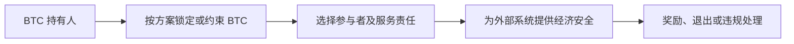

# BTCFi：让 BTC 参与金融活动时，新增了哪些信任

[← 学习总目录](README.md) · [近期热点导航](近期Web3热点导航.md)

> **学习目标**：区分包装 BTC、借贷、Bitcoin 扩展网络和 BTC 质押，追踪资产实际由谁控制。
>
> **建议先读**：[BTC、ETH、SOL 生态对比](BTC、ETH、SOL生态对比.md)、[跨链桥](跨链桥.md)、[DeFi](DeFi.md)。
>
> **选题定位**：比特币生态的持续延伸主题，不把所有方案统一称作已成熟的 Bitcoin L2。2026-11-09 已读取 Babylon 官方仓库对时间戳与质押协议的说明。

展开本篇目录

- [1. BTCFi 是一个集合名称](#section-1)
- [2. 四类路径要分开看](#section-2)
- [3. 包装 BTC 的教学案例](#section-3)
- [4. Bitcoin 质押不是把 Bitcoin 改成 PoS](#section-4)
- [5. 收益与计价币种](#section-5)
- [6. 怎样阅读“Bitcoin L2”宣传](#section-6)
- [7. 自测与参考答案](#section-7)
- [8. 官方资料与继续搜索](#section-8)

---

## 1. BTCFi 是一个集合名称

BTCFi 一般指围绕 BTC 资产的金融应用，例如抵押借贷、交易流动性、收益策略和安全共享。它不是一个统一协议，也没有一个统一风险等级。

有的业务发生在其他链上，使用代表 BTC 的凭证；有的利用 Bitcoin 脚本锁定 BTC；还有的依赖额外网络。首先应问“BTC 现在在哪里”，再问收益是多少。

## 2. 四类路径要分开看

| 路径 | 资产或权利怎样表示 | 核心依赖 |
| --- | --- | --- |
| 包装 BTC | 在另一条链发行对应凭证 | 托管、桥接、储备与赎回 |
| BTC 抵押借贷 | BTC 或其凭证作为担保 | 预言机、清算、贷款资产 |
| 扩展执行网络 | 在额外环境执行应用 | 桥、验证机制、数据与退出 |
| BTC 质押 / 安全共享 | 锁定或约束 BTC 以支持其他系统 | 质押脚本、运营者、惩罚与解锁 |

同样写“BTC 收益”，实际可能是借款人支付利息、交易者支付手续费、其他网络支付安全服务奖励，或项目发行奖励代币。

## 3. 包装 BTC 的教学案例

假设用户向某托管或桥接系统交入 1 BTC，在另一条链获得 1 个凭证。用户还要确认谁保管原资产、凭证怎样兑换、是否有资格或额度限制，以及挤兑时是否仍能按规则退出。

如果凭证投入借贷池，又会增加合约、价格源和清算风险。一个“BTC”标签不意味着这些额外风险都受 Bitcoin 共识保护。

## 4. Bitcoin 质押不是把 Bitcoin 改成 PoS

Bitcoin 本身仍按照其共识规则运行。某些质押方案利用 BTC 的锁定、签名和惩罚设计，为其他系统提供经济担保；这不同于 Bitcoin 矿工生产区块。

Babylon 官方仓库区分 Bitcoin timestamping 与 Bitcoin staking：前者把相关时间戳锚定到 Bitcoin，后者探索用 BTC 支持外部系统的经济安全。两种功能不可互换，也不能仅凭名称判断某资产已经实际接入。

具体能否提前退出、违规如何影响 BTC、是否需要额外参与者，都要按协议版本说明。

## 5. 收益与计价币种

假设锁定 1 BTC，一年收到某奖励代币，按发放当时估值为 0.03 BTC，但卖出时只值 0.01 BTC，最后还支付相关费用，则实现收益显著低于“3%”展示。

若用户用美元衡量结果，还要考虑 BTC 本身价格变化。BTC 数量收益、奖励代币收益和法币收益应分别列出。

质押积分或预期空投没有确定兑换承诺时，不应作为确定利息入账。

## 6. 怎样阅读“Bitcoin L2”宣传

检查链上到底验证了什么：只是把数据哈希写入 Bitcoin，还是存在可执行的争议和退出机制？BTC 由多签、托管机构还是脚本条件控制？运营者停止服务时，用户能否独立取回？

“锚定 Bitcoin”可以指时间戳、数据记录、资产桥或其他关系。它不是一个足够完整的安全描述。EVM 兼容也只是执行能力特征，不说明桥接安全。

## 7. 自测与参考答案

**问题**：抵押包装 BTC 借出稳定币后，为什么 BTC 价格上涨也未必保证盈利？

**答案**：还可能发生凭证折价、借贷成本、下游策略损失、桥接或赎回故障。组合结果由整条路径决定。

**练习**：选一个 BTCFi 产品的公开说明，画出 BTC、包装凭证、借款与奖励四种资产的流向，并列出每个退出步骤。

## 8. 官方资料与继续搜索

- [Babylon 官方仓库](https://github.com/babylonlabs-io/babylon)：本次已读取其 timestamping 与 staking 的职责说明；不据此宣称所有相关产品已上线或安全通过验收。
- [Bitcoin 开发指南](https://developer.bitcoin.org/devguide/)：进一步理解 UTXO 与脚本。
- **检索词**：`BTCFi`、`Bitcoin staking`、`Babylon`、`wrapped BTC redemption`、`Bitcoin L2 trust assumptions`。

---

[← 学习总目录](README.md) · [近期热点导航](近期Web3热点导航.md) · [回到顶部](#top)
