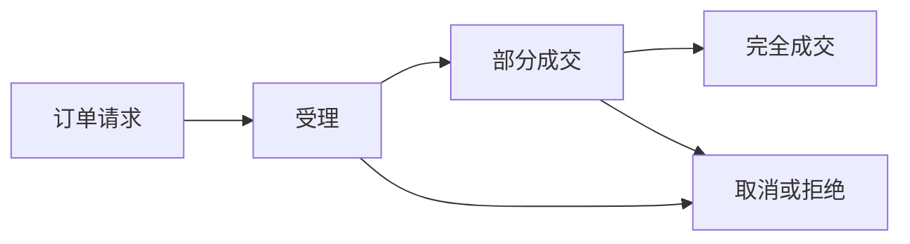

<a id="top"></a>

# CEX 现货：从订单簿到资产到账

[← 返回学习导航](README.md)

> **学习目标**：读懂交易对、订单类型和成交状态，区分平台账本成交与链上转账。
>
> **前置知识**：无需交易经验；数值仅用于教学。

<details>
<summary>展开本篇目录</summary>

- [1. 现货到底买到了什么](#section-1)
- [2. 交易对与单位](#section-2)
- [3. 订单簿怎样撮合](#section-3)
- [4. 订单类型与成交约束](#section-4)
- [5. 费用与盈亏](#section-5)
- [6. 一笔订单的完整状态](#section-6)
- [7. 自测与参考答案](#section-7)
- [8. 延伸阅读](#section-8)

</details>

---


<a id="section-1"></a>

## 1. 现货到底买到了什么

CEX 是中心化交易平台。现货交易通常表示用一种资产交换另一种资产，例如用 USDT 买 BTC。成交后平台更新内部账本，用户获得对应余额或平台所记录的资产权益。

平台内部成交通常不是逐笔链上转账。充值和提现才涉及链上确认或其他结算通道；因此还存在平台托管与提现可用性风险。

这里讨论不借款的普通现货。杠杆现货增加借贷与清算规则，不能与普通现货混为一谈。

<a id="section-2"></a>

## 2. 交易对与单位

在 `BTC/USDT` 中，BTC 是基础资产（base），USDT 是计价资产（quote）。价格 50,000 表示每 1 BTC 值 50,000 USDT。

```text
买入数量 0.01 BTC × 价格 50,000 USDT/BTC = 500 USDT
```

接口中的 `quantity` 常表示基础资产数量，但部分买入接口允许指定计价金额。必须看具体字段定义，不能把“花 500 USDT”写成“买 500 BTC”。

<a id="section-3"></a>

## 3. 订单簿怎样撮合

买盘 bid 表示愿意支付的买价，卖盘 ask 表示愿意接受的卖价。市价买入通常消耗卖盘，市价卖出消耗买盘。

| 卖价 | 可卖数量 | 买入 0.03 BTC 时使用多少 |
| --- | --- | --- |
| 50,000 | 0.01 BTC | 0.01 BTC |
| 50,100 | 0.02 BTC | 0.02 BTC |

总成本为 `500 + 1,002 = 1,502 USDT`，均价约为 `50,066.67`。最新成交价、最优卖价和这笔订单的均价可能都不同。

<a id="section-4"></a>

## 4. 订单类型与成交约束

| 类型 | 作用 | 代价或限制 |
| --- | --- | --- |
| 市价单 | 按可用盘口尽快成交 | 均价不确定，可能受平台价格保护限制 |
| 限价单 | 规定可接受价格边界 | 可能不成交或部分成交 |
| 止损市价 | 达到触发条件后发市价单 | 触发价不保证成交价 |
| 止损限价 | 达到触发条件后发限价单 | 跳空后可能无法成交 |
| Post-only | 尝试只作为挂单方提供流动性 | 会立即吃单时可能被拒绝或取消 |

IOC、FOK 等有效方式会影响剩余订单如何处理，支持情况依平台而定。限价单也可能立即吃单，因此“限价 = maker”并不成立。

<a id="section-5"></a>

## 5. 费用与盈亏

假设花 500 USDT 买入，之后卖出获得 510，买卖手续费各按成交额 0.1% 收取，暂不计其他成本：

```text
净收益 = 510 - 500 - 0.5 - 0.51 = 8.99 USDT
```

手续费可能从基础资产、计价资产或另一个资产扣除，因此实际可卖数量要按成交记录计算。提现费用与交易费用应分开记录。

未卖出部分需要按明确估值方法计入浮动盈亏，不能只展示盈利平仓单而忽略持仓损失。

<a id="section-6"></a>

## 6. 一笔订单的完整状态



请求返回成功通常只代表受理。订单可能尚未成交；取消请求发出时，也可能又发生一笔成交。可靠系统需要结合订单查询与成交明细对账。

用户侧从充值到提现，应逐项确认网络、资产、最小金额、确认数和地址要求。名称相同的资产在不同网络上不一定能直接互通。

<a id="section-7"></a>

## 7. 自测与参考答案

**问题**：撤单成功，是否说明从未成交？

**答案**：不是。可能先部分成交，再取消剩余数量；应查累计成交量与手续费。

**练习**：为“买入 0.03 BTC，只成交 0.01 后撤单”写出基础资产余额变化、计价余额变化和剩余订单数量。

<a id="section-8"></a>

## 8. 延伸阅读

- [CEX 合约](CEX-Contract.md)、[滑点](滑点.md)、[跟单](跟单.md)。
- [Binance Spot API 文档](https://developers.binance.com/docs/binance-spot-api-docs)：学习订单字段与状态，不把示例等同于账户当前费率。

---

[← 返回学习导航](README.md) · [回到顶部](#top)
