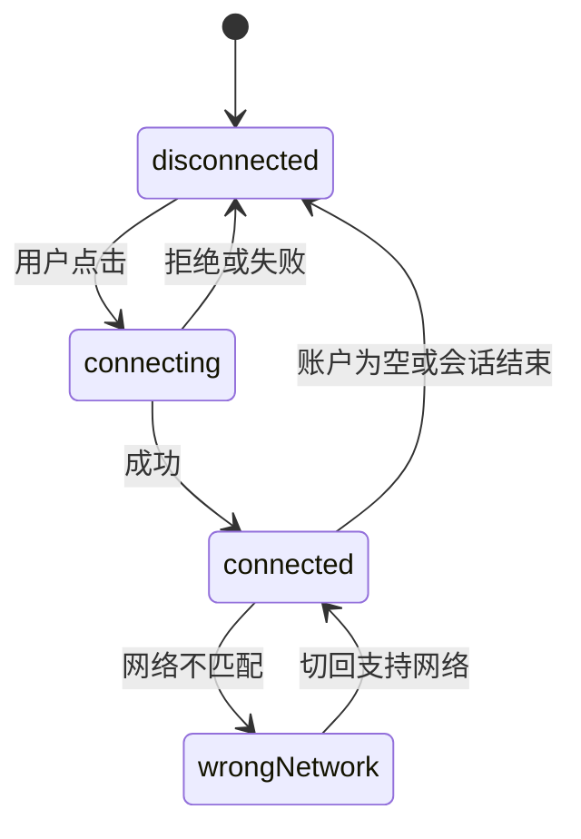

<a id="top"></a>

# Connect Wallet：从连接账户到确认交易

[← 返回学习导航](README.md)

> **学习目标**：分清连接、登录、代币授权和交易签名，建立完整的钱包状态管理。
>
> **建议先读**：[钱包开发分类](钱包开发-分类.md)。示例采用 EVM 的 EIP-1193 Provider 接口。

<details>
<summary>展开本篇目录</summary>

- [1. Connect Wallet 不是一个唯一的库](#section-1)
- [2. 四种动作必须分开](#section-2)
- [3. 最小连接示例](#section-3)
- [4. 状态机比一个布尔值更可靠](#section-4)
- [5. 错误处理与网络切换](#section-5)
- [6. 登录与交易的后续流程](#section-6)
- [7. 自测与参考答案](#section-7)
- [8. 延伸阅读](#section-8)

</details>

---


<a id="section-1"></a>

## 1. Connect Wallet 不是一个唯一的库

“Connect Wallet”通常是连接钱包的产品动作或按钮名称。项目可以使用连接组件、连接器、钱包 SDK 或标准 Provider 来实现；不能仅凭这个名字确定安装哪个包。

MetaMask 等是钱包产品；WalletConnect 是连接通信生态与协议；EIP-1193 定义以太坊 Provider 的请求和事件接口。它们处在不同层级。

<a id="section-2"></a>

## 2. 四种动作必须分开

| 动作 | 得到什么 | 不代表什么 |
| --- | --- | --- |
| 连接账户 | 获准读取钱包暴露的地址 | 不代表登录了后端 |
| 签名登录 | 后端验证用户控制指定地址 | 不代表可以转走代币 |
| 代币授权 | spender 获得指定额度的使用权限 | 不代表兑换已经执行 |
| 签名并发送交易 | 请求一次链上状态变更 | 不代表已成功确认 |

签名也可能授权后续资产操作，例如某些 permit 或订单签名。不能把“没有立即消耗 Gas”解释为“签名没有资金影响”。

<a id="section-3"></a>

## 3. 最小连接示例

下面是浏览器 JavaScript 函数，不依赖 React；`provider` 由应用的钱包发现或连接器层传入。现代多插件环境可使用 EIP-6963 发现多个 Provider，不应默认只有一个 `window.ethereum`。

```javascript
export async function connectWallet(provider, expectedChainId) {
  if (!provider || typeof provider.request !== "function") {
    throw new Error("请选择可用的钱包");
  }
  const accounts = await provider.request({ method: "eth_requestAccounts" });
  const chainId = await provider.request({ method: "eth_chainId" });
  if (!Array.isArray(accounts) || !accounts[0]) {
    throw new Error("钱包没有返回可用账户");
  }
  return {
    account: accounts[0],
    chainId,
    // 例如 0x1 表示 Ethereum 主网；由应用显式传入目标网络。
    wrongNetwork: BigInt(chainId) !== BigInt(expectedChainId),
  };
}
```

由用户点击触发权限请求，并在等待期间禁用重复连接按钮。示例只返回连接结果；真正发送交易前仍应重新核对账户和网络。

<a id="section-4"></a>

## 4. 状态机比一个布尔值更可靠



应用应订阅 `accountsChanged` 和 `chainChanged`，组件卸载时移除监听。账户改变后要失效化旧余额、授权缓存、后端会话和未提交操作，防止把 A 账户的状态用于 B 账户。

刷新页面时可用 `eth_accounts` 查询已有授权状态；不宜在加载时自动反复触发权限弹窗。`disconnect` 事件描述 Provider 连接状态，也不等于用户撤销了所有站点权限。

<a id="section-5"></a>

## 5. 错误处理与网络切换

| 情况 | 常见含义 | 界面动作 |
| --- | --- | --- |
| `4001` | 用户拒绝请求 | 恢复可操作状态，不无限重试 |
| `-32002` | 某些钱包已有待处理请求 | 提示查看钱包窗口 |
| 网络不匹配 | 当前链不是业务目标链 | 显示链名称，提供切换入口 |
| 钱包不认识网络 | 需要添加网络或改用支持网络 | 校验网络配置后再请求 |
| 移动端跳转后无响应 | 会话或深链可能中断 | 查询会话状态，允许重连 |

具体错误码还要依据钱包文档。切换可使用钱包支持的 `wallet_switchEthereumChain`；添加链参数必须来自可信配置，不直接接受 URL 中传入的任意 RPC。

<a id="section-6"></a>

## 6. 登录与交易的后续流程

签名登录应包含域名、地址、链、一次性 nonce、签发与过期时间等，并由后端验证、消费 nonce。不能仅把前端传来的地址当作登录凭证。

交易流程应展示“等待签名 → 已提交 → 等待确认 → 成功或失败”，保存交易哈希，处理取消、替换和超时。断开应用连接不会自动撤销 allowance，也不会取消已广播交易。

<a id="section-7"></a>

## 7. 自测与参考答案

**问题**：用户切换账户后，界面仍显示旧账户余额，可以只改地址文案吗？

**答案**：不可以。应清理或按 `(chainId, account)` 重新获取相关状态，并检查后端认证是否仍匹配。

**练习**：分别验证拒签、重复点击、切链、切账户、刷新恢复和移动端返回六种行为，记录按钮状态与缓存变化。

<a id="section-8"></a>

## 8. 延伸阅读

- [Web3.js 与 ethers.js](Web3.js与ethers.js.md)。
- [EIP-1193](https://eips.ethereum.org/EIPS/eip-1193)、[EIP-6963](https://eips.ethereum.org/EIPS/eip-6963)、[SIWE / EIP-4361](https://eips.ethereum.org/EIPS/eip-4361)。

---

[← 返回学习导航](README.md) · [回到顶部](#top)
