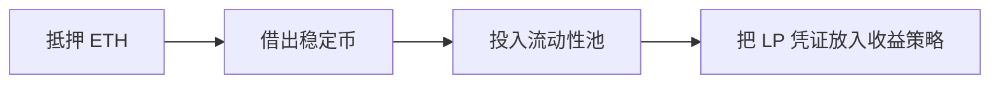

<a id="top"></a>

# DeFi：理解链上金融的资产流与风险链

[← 返回学习导航](README.md)

> **学习目标**：理解兑换、借贷、稳定币和收益来源，并能解释一次组合操作依赖哪些协议。
>
> **建议先读**：[公链](公链.md)、[钱包开发分类](钱包开发-分类.md)。

<details>
<summary>展开本篇目录</summary>

- [1. DeFi 是什么](#section-1)
- [2. 四类常见业务](#section-2)
- [3. 一笔兑换的实际步骤](#section-3)
- [4. 借贷与清算的手算案例](#section-4)
- [5. 收益到底由谁支付](#section-5)
- [6. 可组合性为什么也会传播风险](#section-6)
- [7. 自测与参考答案](#section-7)
- [8. 延伸阅读](#section-8)

</details>

---


<a id="section-1"></a>

## 1. DeFi 是什么

DeFi（Decentralized Finance）指利用区块链与智能合约实现的金融活动，例如兑换、借贷和衍生品。规则可由合约公开执行，用户通常通过钱包交互。

“去中心化”是程度与设计问题。协议仍可能依赖管理员、预言机、托管资产、前端与链基础设施。所谓减少信任，是把部分信任转移到代码和可验证规则，而不是消除所有依赖。

<a id="section-2"></a>

## 2. 四类常见业务

| 业务 | 用户做什么 | 主要收益或成本 | 关键风险 |
| --- | --- | --- | --- |
| DEX 兑换 | 交换两种资产 | 支付交易费、Gas、价格影响 | 滑点、MEV、代币与合约风险 |
| 借贷 | 存入资产或抵押借出 | 存款利息、借款利息 | 清算、坏账、预言机与流动性 |
| LP 做市 | 向市场提供流动性 | 手续费、可能的激励 | 相对持币损失、资产价格风险 |
| 稳定币 | 持有目标锚定某单位的资产 | 转账、结算或协议收益 | 脱锚、储备、赎回与信用 |

DEX 不一定采用 AMM，也可以使用订单簿或其他撮合模式。借贷也不全是无许可超额抵押，机构信用借贷有不同的审核和风险结构。

<a id="section-3"></a>

## 3. 一笔兑换的实际步骤

假设用户用 USDC 换 ETH：钱包连接 → 核对网络和代币地址 → 获取报价 → 必要时授权 spender → 提交兑换 → 检查回执与实际到账。

授权额度与兑换金额不是同一个状态。兑换失败时，之前成功的独立授权交易可能仍然有效。用户还需要准备网络原生资产支付 Gas，除非产品明确提供其他付费机制。

报价应展示输入、预期输出、最低输出、协议费用和网络费。最后收到多少，由实际执行决定，不应由动画或前端缓存决定。

<a id="section-4"></a>

## 4. 借贷与清算的手算案例

采用一个简化的单抵押资产模型：抵押价值 2,000，债务 1,000，清算阈值 80%。

```text
健康因子 = 抵押价值 × 清算阈值 ÷ 债务价值
         = 2,000 × 0.8 ÷ 1,000 = 1.6
```

若抵押价值跌到 1,250，健康因子变成 1；再下跌就可能进入清算范围。实际协议还涉及利息、预言机、不同资产权重、清算奖励与操作规则。

借到的钱不是收益。把借款再投入别的协议，会同时承担借贷成本、下游损失和抵押清算风险。

<a id="section-5"></a>

## 5. 收益到底由谁支付

交易手续费来自交易者；借贷利息来自借款者；质押相关收益依赖网络经济规则；代币激励则通常来自发行或奖励预算。把这些加在一起称为“稳定收益”会掩盖来源差异。

APR 通常是未计复利的年化比例，APY 通常包含某种复利假设。若每日收益率保持 0.01%，理论年化复利为 `(1.0001^365)-1`，但现实利率、奖励币价和复投成本并不固定。

比较策略时至少扣除费用，并把奖励代币价格下跌、无法退出和资金闲置的情况纳入。

<a id="section-6"></a>

## 6. 可组合性为什么也会传播风险



用户看起来只进入一个“收益页面”，底层却可能依赖多个合约与价格源。池子资产脱锚、策略暂停或借款利率上升，都可能影响最终结果。

评估时从退出路径倒推：要取回原始资产，需要赎回哪些凭证、等待哪些状态、支付多少费用？如果市场拥堵，是否仍能及时还款？

<a id="section-7"></a>

## 7. 自测与参考答案

**问题**：一个存款池显示 20% APY，是否代表一年后一定多 20%？

**答案**：不是。它可能是短期收益外推、包含奖励币估值，或假定持续复投；实际收益受利率、币价、费用和损失事件影响。

**练习**：选一个公开协议，只画资金流，不做存款：钱进入哪里、得到什么凭证、谁付收益、怎样退出。

<a id="section-8"></a>

## 8. 延伸阅读

- [流动性池](流动性池.md)、[滑点](滑点.md)、[RWA](RWA.md)。
- [Ethereum DeFi](https://ethereum.org/en/defi/)、[Aave 文档](https://aave.com/docs)。

---

[← 返回学习导航](README.md) · [回到顶部](#top)
