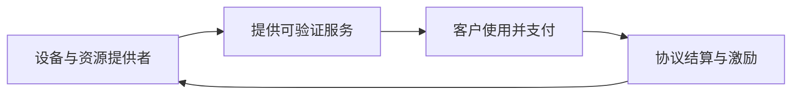

<a id="top"></a>

# DePIN：设备贡献如何变成真实可用的基础设施

[← 学习总目录](README.md) · [近期热点导航](近期Web3热点导航.md)

> **学习目标**：理解硬件供给、需求收入和代币激励的闭环，区分节点数量与有效服务能力。
>
> **建议先读**：[AI + Web3](AI%20+%20Web3.md)、[公链](公链.md)。
>
> **选题依据**：a16z《State of Crypto 2025》讨论 DePIN，并以 Helium 为案例。这是持续发展的赛道，不是 2026 年才出现的技术。资料核验日期：2026-11-09。

<details>
<summary>展开本篇目录</summary>

- [1. DePIN 到底“去中心化”了什么](#section-1)
- [2. 四个角色组成闭环](#section-2)
- [3. 常见方向与验证难点](#section-3)
- [4. 为什么设备证明很重要](#section-4)
- [5. 一台设备的收益账本](#section-5)
- [6. 怎样阅读 DePIN 数据](#section-6)
- [7. 自测与参考答案](#section-7)
- [8. 资料与继续搜索](#section-8)

</details>

---


<a id="section-1"></a>

## 1. DePIN 到底“去中心化”了什么

DePIN 是 Decentralized Physical Infrastructure Networks，常译为去中心化物理基础设施网络。它通过协议、协调和激励机制，让分散参与者提供无线覆盖、存储、计算、传感或其他资源。

分散部署硬件，不等于所有环节都去中心化。设备供应商、任务分配、计费、软件升级和需求销售仍可能由少数主体控制，应分别分析。

<a id="section-2"></a>

## 2. 四个角色组成闭环



如果长期没有客户需求，循环可能变成“买设备 → 领取代币 → 出售给新参与者”。这种过程可以短期扩张，但不能单靠新增节点证明业务成立。

真正值得关注的是客户为什么不用传统服务、网络是否在价格、覆盖或其他能力上提供优势，以及收入能否承担服务成本。

<a id="section-3"></a>

## 3. 常见方向与验证难点

| 方向 | 资源示例 | 怎样判断贡献有效 |
| --- | --- | --- |
| 无线网络 | 热点、覆盖和数据传输 | 真实位置、覆盖质量、实际使用 |
| 算力网络 | GPU 推理、渲染或其他计算 | 任务正确、性能达标、非伪造回执 |
| 存储网络 | 文件副本和检索 | 数据确实保存、可取回、持续可用 |
| 传感网络 | 地图、环境或能源数据 | 设备真实性、数据质量、去重 |

渲染、推理和模型训练的带宽与计算要求不同，不能看到 GPU 就认定所有 AI 工作负载都适合。

<a id="section-4"></a>

## 4. 为什么设备证明很重要

假设协议按上传“覆盖位置”发奖励，攻击者可能伪造位置或让多台设备重复申报同一服务。如果按“流量”奖励，也可能产生刷量。

因此奖励应尽可能与可验证服务和真实需求关联，同时考虑女巫攻击、设备串谋和数据重放。上链记录本身只能保证记录可追溯，不能自动保证硬件真的完成了工作。

<a id="section-5"></a>

## 5. 一台设备的收益账本

假设设备成本 600，每月电费和维护 20，真实服务净收入 35，另有按当前价格估值 15 的代币奖励：

```text
包含奖励的月度贡献 = 35 + 15 - 20 = 30
不含奖励的月度贡献 = 35 - 20 = 15
静态回本时间：600 / 30 = 20 个月
```

这个回本时间假定需求、成本和币价都不变，未计故障、折旧、税费与资金成本。奖励价格下跌或网络参与者增加，都可能拉长周期。

评估时必须同时展示含补贴与不含补贴结果，不能只把奖励币数量换算成最好时期的价格。

<a id="section-6"></a>

## 6. 怎样阅读 DePIN 数据

有效服务节点比注册节点更有意义；付费客户和实际用量比社交关注度更接近需求；收入来源也要区分外部客户与生态内部补贴。

对 Helium 等具体案例，应按官方当期文档核对网络类型、奖励制度与设备要求。不同版本下的资产和收益分配可能变化，本文不提供固定收益承诺。

<a id="section-7"></a>

## 7. 自测与参考答案

**问题**：网络节点翻倍，服务收入没变化，是否说明参与者收益也会翻倍？

**答案**：不一定。需求不变时，新增供给可能稀释每个节点的任务和奖励；还可能出现低利用率。

**练习**：给一种设备列出购买成本、维护成本、真实客户收入、代币奖励和残值五项，分别模拟币价减半与需求减半。

<a id="section-8"></a>

## 8. 资料与继续搜索

- [State of Crypto 2025](https://a16zfrontier.com/posts/article/state-of-crypto-report-2025/)：本次已核实其 DePIN 与 Helium 讨论，不把报告中的历史数据写成实时值。
- [Helium 官方文档](https://docs.helium.com/)：进一步学习入口；本次直连超时，已确认 [官方文档仓库](https://github.com/helium/docs) 可访问；未据此断言当前奖励参数。
- **检索词**：`DePIN`、`decentralized physical infrastructure`、`Helium network`、`decentralized GPU`、`DePIN revenue`。

---

[← 学习总目录](README.md) · [近期热点导航](近期Web3热点导航.md) · [回到顶部](#top)
