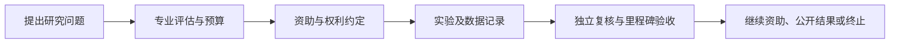

# DeSci 与 BioAgents：科研融资上链，哪些事情仍要在实验室完成

[← 学习总目录](README.md) · [近期热点导航](近期Web3热点导航.md)

> **学习目标**：理解科研资助、BioDAO、知识产权凭证与 AI 科研助手，区分资金热度和科学证据。
>
> **建议先读**：[RWA](RWA.md)、[AI + Web3](AI%20+%20Web3.md)、[ERC-8004](ERC-8004与智能体身份.md)。
>
> **资料核验**：2026-11-09 已读取 BIO 官方概念与 BioAgents 页面。本篇按应用机制补课，不把项目方对科研加速的愿景当成已验证的临床成果或热搜数据。

展开本篇目录

- [1. DeSci 在尝试改变什么](#section-1)
- [2. 几个常见名词](#section-2)
- [3. 从资助到研究结果的流程](#section-3)
- [4. 10 万资助如何拆成可检查阶段](#section-4)
- [5. BioAgents 能在哪些环节提供帮助](#section-5)
- [6. 代币权利与科学价值要分别看](#section-6)
- [7. 自测与参考答案](#section-7)
- [8. 官方资料与继续搜索](#section-8)

---

## 1. DeSci 在尝试改变什么

DeSci（Decentralized Science，去中心化科学）探索用开放协作、透明资助、可追踪贡献和链上组织工具改善科研过程。它不等于把论文铸造成 NFT，也不要求所有研究数据公开上链。

科研通常面临资助周期长、数据难复用、贡献难追踪和成果商业化复杂等问题。链上记录可以帮助对账与协作，但实验设计、数据质量和同行评议仍然需要专业方法。

## 2. 几个常见名词

| 概念 | 主要职责 | 不能自动保证什么 |
| --- | --- | --- |
| BioDAO | 围绕研究方向组织资助和治理 | 投票能替代专业实验判断 |
| IP-NFT / IP-Token | 表达与知识产权相关的合同权利或管理关系 | 持币者自动取得专利所有权 |
| BioAgent | 辅助科研或运营任务的 AI Agent | 自动完成可靠实验或临床验证 |
| 开放科研记录 | 追踪数据、版本、贡献和里程碑 | 数据本身真实且研究可复现 |

具体产品可以对这些名称赋予不同规则。判断权利时应读取实际合同、发行条款和治理权限，不靠术语推定。

## 3. 从资助到研究结果的流程

一个合理项目应允许产生负结果。若资金只奖励“成功发现”，可能诱导选择性报告或夸大结论，反而损害科研质量。

链上里程碑付款应绑定可审查的交付标准，例如完成特定实验记录与复核，而不是模糊的“项目影响力增加”。

## 4. 10 万资助如何拆成可检查阶段

教学例子：总预算 100,000，第一阶段 20,000 用于材料与研究设计，第二阶段 50,000 用于实验，第三阶段 30,000 用于复核和整理。

资助合同要说明未完成时怎样处理剩余预算，原始数据和设备归谁，研究者离开后谁能继续工作，以及负结果如何披露。

即使资金路径透明，也不能直接推断款项都被有效使用。现实采购、实验记录和专业审查仍需与链上账本对齐。

## 5. BioAgents 能在哪些环节提供帮助

BIO 官方资料把 BioAgents 描述为参与科研与开发生命周期的 AI 实体。可研究的任务包括文献整理、数据分析、候选假设生成和流程协调。

可靠实现应记录使用了什么文献与数据、哪个模型或程序版本、哪些结论来自推断、哪些经过实验验证。模型生成一段看似专业的机制解释，不等于已经发现有效治疗方案。

涉及敏感研究资料时，要控制访问与披露；涉及实验执行时，要有符合场景的专业审核，而不是仅以 Agent 链上身份或声誉评分批准高风险操作。

## 6. 代币权利与科学价值要分别看

某代币可能只提供治理权，也可能代表合同中的部分收益权或其他权利。科研产生专利，不代表代币必然获得收入；专利能否商业化，还取决于有效性、市场需求、许可与后续开发。

同样，代币交易活跃不等于研究取得进展。评估时应分别看研究设计、数据、复核、知识产权条款和财务披露。

## 7. 自测与参考答案

**问题**：DAO 大多数人投票认定实验成功，能否替代独立复现？

**答案**：不能。投票可以决定资金或治理事项，但科学结论需要数据和方法支持，不能由持币比例决定真假。

**练习**：设计一个允许失败的研究资助合同，列出负结果披露、数据访问、阶段验收和未使用预算退回的规则。

## 8. 官方资料与继续搜索

- [BIO 概念文档](https://docs.bio.xyz/bio/introduction/concepts)：DeSci、BioDAO、IP-Tokens 等定义入口。
- [BIO：BioAgents](https://docs.bio.xyz/bio/introduction/bioagents)：官方描述的任务范围与架构入口。
- **检索词**：`DeSci`、`decentralized science`、`BioDAO`、`BioAgents`、`IP-NFT IP-Token`。
- **关注度说明**：科研与 AI Agent 的交叉应用是选题理由，本文没有声称某研究或代币位居搜索榜前列。

---

[← 学习总目录](README.md) · [近期热点导航](近期Web3热点导航.md) · [回到顶部](#top)
