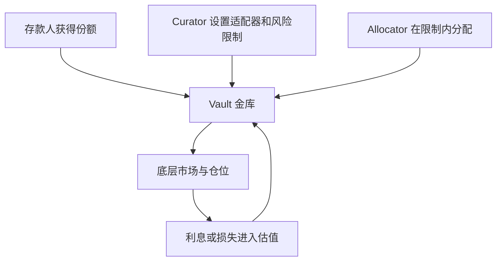

<a id="top"></a>

# ERC-4626 与策展型金库：存入资产以后，谁替你做决定

[← 学习总目录](README.md) · [近期热点导航](近期Web3热点导航.md)

> **学习目标**：分清资产与份额、接口标准与投资策略，理解策展人和分配者的权限，并计算金库净值。
>
> **前置知识**：[DeFi](DeFi.md)、[风险控制与监控](风险控制与监控.md)。
>
> **资料核验：2026-11-09**。ERC-4626 是已有正式标准，策展型金库是其重要应用方向；本文不将标准包装为刚发布的新概念。

<details>
<summary>展开本篇目录</summary>

- [1. 金库是共同使用策略的资金容器](#section-1)
- [2. ERC-4626 标准化的到底是什么](#section-2)
- [3. 资产与份额的手算](#section-3)
- [4. 以 Morpho Vault V2 理解角色](#section-4)
- [5. 非托管为什么仍然要查退出路径](#section-5)
- [6. 评估金库时看这张表](#section-6)
- [7. 自测与参考答案](#section-7)
- [8. 官方资料与检索词](#section-8)

</details>

---


<a id="section-1"></a>

## 1. 金库是共同使用策略的资金容器

用户向金库存入资产，获得代表相应权益的份额。金库按规则配置资产，可能进行借贷、流动性管理或其他策略。用户持有的份额数量与每份净值，共同决定其权益。

策展型金库把策略选择进一步拆成角色：有人负责设定可使用的市场与风险限额，有人在限额内调配资金。这样用户不必亲自逐个管理底层仓位，但仍需要理解管理权限和底层资产风险。

“策展”可以理解为筛选与组织，不表示筛选过的市场一定不会亏损。

<a id="section-2"></a>

## 2. ERC-4626 标准化的到底是什么

ERC-4626 定义围绕单一 ERC-20 底层资产的代币化金库接口，包括存入、铸造份额、提取资产和赎回份额。它让应用更容易以统一方式接入金库。

| 操作 | 用户指定什么 | 需要计算什么 |
| --- | --- | --- |
| deposit | 存入多少资产 | 得到多少份额 |
| mint | 希望铸造多少份额 | 需要多少资产 |
| withdraw | 希望取出多少资产 | 需要销毁多少份额 |
| redeem | 销毁多少份额 | 能取回多少资产 |

标准不规定资金必须投资哪里，也不保证收益率、可用流动性或合约安全。两份兼容接口的金库可以具有完全不同的策略。

`convertToShares`、`convertToAssets` 侧重理想化换算；`preview` 系列针对对应操作的估算，应考虑规范要求的费用与取整等因素。预览不是锁定报价，交易前状态仍可能变化。

<a id="section-3"></a>

## 3. 资产与份额的手算

忽略费用、取整和特殊会计，假设金库总资产 1,000、总份额 1,000，则每份净值为 1。策略产生收益后，总资产升至 1,100，份额仍为 1,000：

```text
每份净值 = 总资产 / 总份额 = 1100 / 1000 = 1.10
持有 100 份的权益 = 100 × 1.10 = 110
```

此时新用户存入 110，应得到 100 份。存入后资产 1,210、份额 1,100，每份仍为 1.10。新存款本身没有给旧用户创造收益。

反过来，若策略损失导致资产降至 990、份额为 1,100，每份净值就是 0.90。份额数量没变，资产权益也会减少。

<a id="section-4"></a>

## 4. 以 Morpho Vault V2 理解角色



Morpho Vault V2 官方仓库区分 owner、curator、allocator，并提供 sentinel 等角色。本文主要关注策展人设置规则、分配者执行资金配置的分工，不把 V1 和 V2 的权限混为一谈。

V2 通过 adapter 连接底层市场，并设置绝对或相对上限。共享同一风险因素的仓位可以被放入相应限制中；这比只按市场数量衡量分散程度更有意义。

治理延时是否有效，要看具体函数和实际配置。代码支持 timelock，不表示部署者必然设置了足够长的等待期。

<a id="section-5"></a>

## 5. 非托管为什么仍然要查退出路径

非托管强调资产受合约和权限规则约束，但不能推出“任何时候都能立即拿到足额现金”。底层市场可能没有闲置流动性，提取也可能受具体权限或门控配置影响。

Morpho Vault V2 文档讨论闲置流动性、流动性适配器、强制撤回分配及实物形式退出。接收底层仓位和拿回可立即使用的基础资产不是同一体验，还可能涉及费用或复杂操作。

一个重要接入细节：核验时 V2 README 明确说明其 `maxDeposit`、`maxMint`、`maxWithdraw`、`maxRedeem` 返回值存在非常规行为，均返回零。集成者不能只套用普通 ERC-4626 UI 逻辑就断言金库永久无法操作，应核对当前版本的集成说明和实际执行路径。

<a id="section-6"></a>

## 6. 评估金库时看这张表

| 检查项 | 关注的问题 |
| --- | --- |
| 底层策略 | 收益来自借款利息、费用还是补贴？ |
| 风险集中 | 多个市场是否依赖同一种抵押品或价格源？ |
| 管理权限 | 谁能增加市场、提高限额或设置门控？ |
| 费用结构 | 管理费与业绩费如何计算、何时收取？ |
| 退出条件 | 底层流动性不足时，能拿回什么？ |

ERC-4626 的初始份额、取整与资产直接转入等行为还可能引出捐赠或通胀攻击问题。是否存在漏洞取决于具体实现和保护机制，不能说所有标准金库必然受影响，也不能说符合标准就已经解决。

<a id="section-7"></a>

## 7. 自测与参考答案

**题目一**：金库资产从 1,000 增至 2,000，是否代表赚了 100%？

**答案**：不一定。如果增加部分来自新存款，总份额也可能同步增加，每份净值未必改变。

**题目二**：持有 80 份，每份净值 1.25，赎回前资产权益是多少？

**答案**：100 单位底层资产，实际到账还需考虑费用、取整、可用流动性和交易时状态。

**实践练习**：画出一个金库的权限图，标出谁能调市场、谁能分配、谁能紧急降低风险，以及哪些操作有等待时间。缺失的权限信息应记为未知，而不是默认无人控制。

<a id="section-8"></a>

## 8. 官方资料与检索词

- [ERC-4626 正式规范](https://eips.ethereum.org/EIPS/eip-4626)：状态为 Final，提案创建于 2021-12-22。
- [Morpho Vault V2 官方仓库](https://github.com/morpho-org/vault-v2)：角色、适配器、风险上限、退出与接口差异。

**检索词**：ERC-4626、curated vault、Morpho Vault V2、金库份额净值、curator allocator。

**继续阅读**：[收益代币化与 Pendle](收益代币化与Pendle.md)，比较金库份额与 PT/YT 的权利差异。

---

[← 学习总目录](README.md) · [近期热点导航](近期Web3热点导航.md) · [回到顶部](#top)
