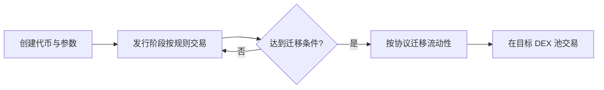

<a id="top"></a>

# Four.meme：理解 Meme 代币发行平台的生命周期

[← 返回学习导航](README.md)

> **学习目标**：分清发行平台、平台上的代币和 Meme 文化，读懂曲线发行与迁移流程。
>
> **建议先读**：[流动性池](流动性池.md)、[滑点](滑点.md)。

<details>
<summary>展开本篇目录</summary>

- [1. 先纠正名称](#section-1)
- [2. 发行平台在做什么](#section-2)
- [3. 常见生命周期](#section-3)
- [4. 用简化曲线理解平均成本](#section-4)
- [5. 阅读一个代币需要检查什么](#section-5)
- [6. 为什么毕业不等于赚钱](#section-6)
- [7. 自测与参考答案](#section-7)
- [8. 延伸阅读](#section-8)

</details>

---


<a id="section-1"></a>

## 1. 先纠正名称

本篇的 Four.meme 指 BNB Chain 生态中的 Meme 代币发行平台，**不是 DOGE、SHIB、PEPE、FLOKI 四种币的合称**。若资料中的同名词另有所指，需要结合网址和项目上下文确认。

Meme 代币通常依赖社区传播、文化符号和市场情绪形成关注，但“社区活跃”不能直接证明资产有现金流、退出流动性或长期价值。

平台规则、费率、发行模板和迁移条件可能调整。本文讲阅读机制的方法，不把固定百分比或历史门槛写成当前平台承诺。

<a id="section-2"></a>

## 2. 发行平台在做什么

平台常把创建代币、初始交易和流动性迁移整理成标准化流程，让发行者不必从零搭建所有合约和界面。

标准化降低操作门槛，但不代表每个代币经过价值审核。平台合约的行为、发行者权限和某个代币的市场前景，应分别评估。

<a id="section-3"></a>

## 3. 常见生命周期



Bonding Curve（绑定曲线）通常根据供给或储备决定价格。迁移或“毕业”意味着达到某个协议定义的阶段，不代表交易收益得到保证。

具体产品可能有不同模式，应查看当前页面、合约与正式文档，而不是把所有发币平台都套成同一条曲线。

<a id="section-4"></a>

## 4. 用简化曲线理解平均成本

假设仅用于教学的线性边际价格为 `p(q) = 1 + 0.01q`，q 是已出售数量。从 q=0 买到 q=10：

```text
成本 = ∫(1 + 0.01q)dq，从 0 到 10
     = 10 + 0.005 × 100 = 10.5
平均成本 = 1.05
末端边际价格 = 1.10
```

这不是 Four.meme 的实际定价公式，只说明平均成交价格与最后一单位价格不同。费用、取整和实际曲线会改变结果；反向卖出也要沿曲线计算。

<a id="section-5"></a>

## 5. 阅读一个代币需要检查什么

| 项目 | 为什么重要 |
| --- | --- |
| 网络与合约地址 | 同名代币和仿冒页面可能混淆 |
| 发行模板与权限 | 是否可增发、限制转账或修改参数 |
| 持有人分布 | 集中持仓可能影响抛售与流动性 |
| 迁移规则 | 资金如何进入 DEX、谁管理 LP 权益 |
| 完整费用 | 发行、买卖、迁移及网络成本分别多少 |
| 可执行退出 | 实际卖出是否成功，深度能承接多少 |

不能仅凭“销毁权限”“锁定流动性”等标签作判断，应核对对应合约、期限、例外权限和真实持仓分布。

<a id="section-6"></a>

## 6. 为什么毕业不等于赚钱

进入 DEX 后，价格由新池子的交易行为决定。大量卖出、流动性撤出或需求下降都可能改变价格。较高市值也不代表同等规模资金可以立即退出，因为市值常由边际价格乘供应量得到。

交易时还要考虑曲线阶段与 DEX 阶段的报价方式差异、滑点边界和 MEV 暴露。营销热度不能替代对账和执行检查。

<a id="section-7"></a>

## 7. 自测与参考答案

**问题**：代币市值 100 万，是否意味着所有持有人合计能卖出 100 万？

**答案**：不是。市值是估值指标，实际退出收入由可用买盘、曲线或池深度决定，大额卖出会改变价格。

**练习**：仅阅读公开资料，记录某代币的链、合约、发行阶段、迁移条件来源和费用说明；未知项目保留为未知，不靠宣传补全。

<a id="section-8"></a>

## 8. 延伸阅读

- [防夹](防夹.md)、[CEX 现货](CEX-Spot.md)。
- [Four.meme 官方入口](https://four.meme/)：通过官方入口查当期规则，本文未验证其当前费率、阈值与可用性。

---

[← 返回学习导航](README.md) · [回到顶部](#top)
