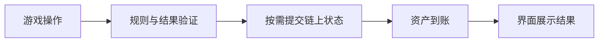

# GameFi：把游戏体验、资产和经济系统分开理解

[← 返回学习导航](README.md)

> **学习目标**：理解链上资产在游戏中的作用，并能检查奖励经济是否依赖持续新增资金。
>
> **建议先读**：[公链](公链.md)、[DeFi](DeFi.md)。

展开本篇目录

- [1. GameFi 不只是“玩游戏赚钱”](#section-1)
- [2. 游戏中哪些东西可以上链](#section-2)
- [3. 用水池理解奖励经济](#section-3)
- [4. 核心经济指标](#section-4)
- [5. 开发流程应该怎样拆](#section-5)
- [6. 常见误区](#section-6)
- [7. 自测与参考答案](#section-7)
- [8. 延伸阅读](#section-8)

---

## 1. GameFi 不只是“玩游戏赚钱”

GameFi 是游戏与链上资产、经济激励等机制结合的概括。某些产品强调 Play-to-Earn，另一些更强调可交易道具、创作者市场或链上规则。

不是所有区块链游戏都需要 DeFi，也不是游戏中的每一次操作都必须上链。判断产品时，先看玩法为何需要这套技术，再看代币和奖励。

## 2. 游戏中哪些东西可以上链

| 对象 | 可能上链的内容 | 通常仍依赖什么 |
| --- | --- | --- |
| 道具或角色 | 归属、转让、稀缺规则 | 图片资源、数值解释、服务器 |
| 游戏货币 | 发行、余额和转移 | 使用场景与交易深度 |
| 战斗或关卡结果 | 状态转换或结果证明 | 具体游戏的执行与验证设计 |
| 社区决策 | 提案或投票记录 | 权限范围、执行主体 |

拥有一个 NFT 通常只证明对该代币的控制，并不自动获得图片版权，也不保证服务器关闭后道具仍有用途。资产可转移与游戏可持续运行是不同承诺。

## 3. 用水池理解奖励经济

把奖励池想成水池：玩家真实付费、内容消费等是流入，奖励、运营和服务成本是流出。代币增发可以增加奖励数量，但不能凭空增加购买力。

**例子**：每天向玩家发 10 万代币，同时只有 2 万代币用于购买道具并被消耗。其他条件不变时，新增可流通供给持续累积；若需求不增长，奖励的市场价值可能承压。

这里还要区分“销毁”与“转给项目方”：转入项目金库的代币以后可能再次出售，不等于永久减少供应。

## 4. 核心经济指标

| 指标 | 观察重点 | 不能直接推出什么 |
| --- | --- | --- |
| 活跃与留存 | 用户是否愿意持续游玩 | 地址数不等于真实玩家 |
| 付费收入 | 是否来自真实娱乐消费 | 代币交易量不等于游戏收入 |
| 奖励与消耗 | 发行是否匹配需求 | 高销毁量不一定改善体验 |
| 道具分布 | 大户与新玩家是否失衡 | NFT 稀缺不等于需求稳定 |
| 退出流动性 | 挂单深度与成交情况 | 标价不等于可卖出价 |

应分别统计游戏娱乐收益和资产投机收益。如果玩家留存只随奖励价格变化，经济系统对市场行情的依赖可能很强。

## 5. 开发流程应该怎样拆

需要由权威规则决定结果，再让动画呈现；不能由前端动画决定稀有道具或资金发放。随机性、反作弊与服务器权限都应明确设计。

钱包体验还要处理首次入场、Gas、授权范围、资产恢复和交易等待。会话权限可以降低交互频率，但应限制用途、额度与有效期，并有撤销路径。

## 6. 常见误区

“多发奖励能永久留住玩家”忽略了供给压力和奖励成本；“NFT 能跨所有游戏通用”忽略了数值、版权和程序兼容；“完全上链就没有作弊”忽略了输入真实性、机器人与协议漏洞。

项目例子应按实际玩法分类。例如 Move-to-Earn 运动激励不应直接当成典型竞技 PvP。产品分类帮助分析机制，不用于推断某项目当前运营状态。

## 7. 自测与参考答案

**问题**：项目发了很多代币，玩家账户资产数增加，是否就是创造了等量经济价值？

**答案**：不是。数量增长与可兑现价值不同，需要实际需求、流动性和持续收入支撑。

**练习**：设计一个不依赖币价上涨的道具消费场景，并说明玩家为什么愿意付费、发行方如何覆盖成本。

## 8. 延伸阅读

- [SocialFi](SocialFi.md)、[Layer3](Layer3.md)、[连接钱包](Connectwallet.md)。
- [ERC-721](https://eips.ethereum.org/EIPS/eip-721)、[ERC-1155](https://eips.ethereum.org/EIPS/eip-1155)。

---

[← 返回学习导航](README.md) · [回到顶部](#top)
