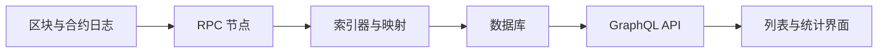

<a id="top"></a>

# GraphQL 与链上索引：怎样获取可追溯的数据

[← 返回学习导航](README.md)

> **学习目标**：理解 RPC、索引器和 GraphQL 的分工，避免把“最新返回”当成“链上最终状态”。
>
> **建议先读**：[公链](公链.md)、[流动性池](流动性池.md)。

<details>
<summary>展开本篇目录</summary>

- [1. GraphQL 本身不监听区块链](#section-1)
- [2. 数据怎样到达界面](#section-2)
- [3. Query、Mutation、Subscription 分别是什么](#section-3)
- [4. 一个明确限定 schema 的查询](#section-4)
- [5. 最小请求代码](#section-5)
- [6. 如何实现接近实时的更新](#section-6)
- [7. 自测与参考答案](#section-7)
- [8. 延伸阅读](#section-8)

</details>

---


<a id="section-1"></a>

## 1. GraphQL 本身不监听区块链

GraphQL 是 API 查询语言与执行规范，让客户端按 schema 请求需要的字段。它不是节点、索引器或区块链共识协议。

索引器负责从节点读取区块和日志，按规则转换成查询实体；GraphQL 可以成为这些实体的查询接口。索引延迟、映射错误和链重组都会影响返回数据。

<a id="section-2"></a>

## 2. 数据怎样到达界面



例如工厂合约发出创建池子事件，索引器提取 token 地址、池子地址、区块号和交易哈希，再形成 `Pool` 实体。客户端查询该实体，就不必每次重新扫描所有历史区块。

事件存在不代表索引器已处理；接口有结果不代表已达到业务所需最终性。因此页面最好能展示“数据截至哪个区块”，重要操作前再读取权威状态。

<a id="section-3"></a>

## 3. Query、Mutation、Subscription 分别是什么

| 操作 | 用途 | 链上场景中的边界 |
| --- | --- | --- |
| Query | 读取服务端暴露的数据 | 读取池列表、统计或历史 |
| Mutation | 按服务端定义修改数据 | 不天然等于链上交易 |
| Subscription | 订阅服务端支持的事件流 | 必须有实际 schema 与传输支持 |

**不能把一个 HTTP 地址改为 WSS 就获得订阅能力。** The Graph 的常见 Subgraph 查询端点应按其提供的查询能力使用，不能默认支持任意 GraphQL subscription。Apollo Client 支持订阅，也不意味着服务端支持。

<a id="section-4"></a>

## 4. 一个明确限定 schema 的查询

以下是**自定义教学 schema** 的假设查询，不保证任何现成 Subgraph 都有这些字段。接入时先阅读实际 schema，再修改字段与过滤方式。

```graphql
query PoolsAfter($after: ID!, $first: Int!) {
  pools(first: $first, orderBy: id, orderDirection: asc,
        where: { id_gt: $after }) {
    id
    token0
    token1
    createdAtBlock
  }
}
```

假设实体 ID 可按服务定义稳定排序，分页时把最后一个 ID 作为下页游标。全量导出还应固定查询区块快照，否则分页期间新增或重组的数据可能造成遗漏或不一致。

<a id="section-5"></a>

## 5. 最小请求代码

浏览器或支持 `fetch` 的 JavaScript 环境可使用下列函数。端点与鉴权配置由调用方管理，示例不依赖 Apollo，也不包含密钥。

```javascript
export async function queryGraphQL(endpoint, query, variables, signal) {
  const response = await fetch(endpoint, {
    method: "POST",
    headers: { "Content-Type": "application/json" },
    body: JSON.stringify({ query, variables }),
    signal,
  });
  if (!response.ok) throw new Error(`HTTP ${response.status}`);
  const payload = await response.json();
  if (payload.errors?.length) {
    throw new Error("GraphQL 返回错误，请检查查询与 schema");
  }
  if (payload.data == null) throw new Error("查询未返回数据");
  return payload.data;
}
```

GraphQL 可能在 HTTP 200 下返回 `errors`，也可能同时包含部分 `data`。示例选择遇到错误整体失败；如果产品接受部分结果，应明确标注缺失内容。请求取消可通过 `AbortController` 实现。

<a id="section-6"></a>

## 6. 如何实现接近实时的更新

**轮询索引 API**：实现简单，适合列表和统计。控制间隔、失败退避、页面隐藏时暂停，并记录最后处理的区块或游标。

**订阅 RPC 日志**：反馈更快，但断线可能漏事件。重连后从持久化区块号补查，按链 ID、交易哈希和日志索引去重，并处理被重组移除的日志。

**自建推送服务**：后端将索引结果推给客户端，可以使用 WebSocket 或 GraphQL subscription；可靠性仍依赖后端补偿与重放设计。

<a id="section-7"></a>

## 7. 自测与参考答案

**问题**：只轮询 `first: 1` 的最新池子，能保证不漏池吗？

**答案**：不能。两次轮询之间创建多个池子时，中间事件会被跳过。应采用游标、区块范围补查或可重放事件流。

**练习**：设计一次断线 10 分钟后的恢复过程，列出补查起点、去重键和重组处理办法。

<a id="section-8"></a>

## 8. 延伸阅读

- [风险控制与监控](风险控制与监控.md)：数据过期如何阻止错误决策。
- [GraphQL 官方学习文档](https://graphql.org/learn/)、[The Graph 文档](https://thegraph.com/docs/)。

---

[← 返回学习导航](README.md) · [回到顶部](#top)
