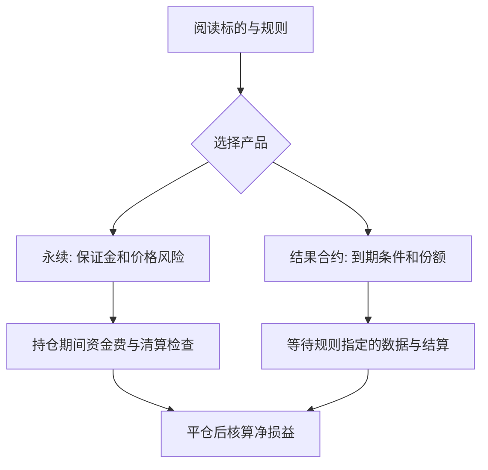

<a id="top"></a>

# HIP-3 与 HIP-4：从自建永续市场到结果合约

[← 学习总目录](README.md) · [近期热点导航](近期Web3热点导航.md)

> **学习目标**：区分开放建市、永续合约和结果合约，理解市场部署者承担的职责，并计算两类产品的损益。
>
> **前置知识**：[Perp DEX 与 Hyperliquid](PerpDEX与Hyperliquid.md)、[预测市场](预测市场与Polymarket.md)。
>
> **资料核验：2026-11-09**。本篇依据 HIP 官方文档解释机制；上线范围、费用和准入参数需以目标市场当时配置为准。

<details>
<summary>展开本篇目录</summary>

- [1. 先理解：交易所提供什么，建市者负责什么](#section-1)
- [2. HIP-3 的责任拆分](#section-2)
- [3. HIP-4：到期后在规定范围内结算](#section-3)
- [4. 从市场规则到最终损益](#section-4)
- [5. 两个手算案例](#section-5)
- [6. 三个最容易误读的细节](#section-6)
- [7. 自测与参考答案](#section-7)
- [8. 官方资料与检索词](#section-8)

</details>

---


<a id="section-1"></a>

## 1. 先理解：交易所提供什么，建市者负责什么

HIP 是 Hyperliquid Improvement Proposal 的缩写。HIP-3 讨论由构建者部署永续合约市场，HIP-4 讨论在固定范围内结算的结果合约。二者都扩展交易能力，但并不是同一种产品。

HIP-3 的关键变化是把部分“上什么市场、用什么价格、设置什么参数”的决定交给部署者，同时复用底层交易基础设施。这让更多标的可以形成市场，也把评估市场规则的责任带到用户面前。

交易界面看起来相似，不代表不同市场拥有相同预言机、参数控制权和异常处理规则。

<a id="section-2"></a>

## 2. HIP-3 的责任拆分

| 层次 | 主要内容 | 阅读时要追问 |
| --- | --- | --- |
| HyperCore 基础设施 | 订单簿、保证金与撮合等能力 | 该市场采用什么保证金设置？ |
| 市场部署者 | 合约规格、价格来源、杠杆限制与运营 | 谁能调参，价格中断如何处理？ |
| 价格数据源 | 参考价格与更新 | 数据覆盖什么交易时段？ |
| 用户与交易前端 | 下单、风险展示、仓位管理 | 是否识别了正确市场和资产 ID？ |

官方规范包含部署者质押与约束机制。具体门槛会变化，本篇不把某个 HYPE 数量写成永久准入条件。质押约束也不能理解为“所有交易亏损都会赔付”。

例如，一个跟踪非全天交易标的的永续市场，需要解释休市期间的参考价格。如果报价停止而链上继续交易，用户仍面临价格偏离与清算问题。

<a id="section-3"></a>

## 3. HIP-4：到期后在规定范围内结算

HIP-4 的 Outcome 是充分抵押、具有到期结算条件的合约，可用于预测市场和部分有界收益产品。其原语不依靠永续合约式的杠杆和清算来实现收益结构。

| 维度 | HIP-3 永续市场 | HIP-4 结果合约 |
| --- | --- | --- |
| 时间 | 通常没有固定到期日 | 有规定的结算时间或条件 |
| 损益 | 跟随价格变化，并受资金费等影响 | 根据结果规则在固定范围内结算 |
| 资本结构 | 使用保证金，可能触发清算 | Outcome 原语采用充分抵押 |
| 核心信息 | 标记价格、杠杆、资金费率 | 问题定义、结算数据与结果份额 |

官方文档说明初始市场采用每日 BTC 标记价格相关的二元结果，并对扩展功能分阶段推出。文档还讨论 Questions 和多结果机制，但这不能当成所有功能已在所有环境开放的证据。

“结果合约无需清算”应限定在该原语范围；若用户另行借款买入，借款仓位依然可能被清算。

<a id="section-4"></a>

## 4. 从市场规则到最终损益



先判断自己需要的是持续价格敞口，还是针对某个截止时点的结果敞口，再评估流动性和成本。二者表达的判断不同：看好长期价格上涨，不等于某一天某个时间点必然超过某个阈值。

<a id="section-5"></a>

## 5. 两个手算案例

**案例 A：线性永续。** 假设买入 2 单位标的，开仓价 100、平仓价 110，合约按报价资产线性结算。

```text
价格损益 = 2 × (110 - 100) = 20
净损益   = 20 - 交易费 - 净支付资金费
```

若初始保证金为 40，价格损益相当于其 50%，但这不代表仓位期间不会触发风险限制；实际清算看标记价格和维持保证金。

**案例 B：二元 Yes 份额。** 假设 100 份 Yes，每份买价 0.40，获胜每份结算 1 单位报价资产，失败每份为 0。

```text
初始成本 = 100 × 0.40 = 40
获胜毛利润 = 100 - 40 = 60
失败毛损益 = 0 - 40 = -40
```

以上未扣费用。0.40 可以作为市场隐含概率的粗略读法，但流动性、价差与参与者偏差会影响价格，不能说真实事件概率精确等于 40%。

<a id="section-6"></a>

## 6. 三个最容易误读的细节

**开放建市不等于统一质量。** 同一个底层系统上的两个市场，可以具有不同的预言机设计和管理权限；复用撮合不等于复用标的可靠性。

**Yes 与 No 有关联，不代表免费套利。** 官方设计使对某一侧的买卖可以映射到另一侧的互补报价，但真实执行仍涉及订单优先级、费用与可成交数量。只看界面两档报价不足以判断套利。

**零费用可能只是阶段设置。** 核验时文档提到结果市场初期测试的费用安排，同时提到 builder code。教学不据此承诺永远零费，执行前应查询该笔订单的完整费用。

<a id="section-7"></a>

## 7. 自测与参考答案

**题目一**：HIP-3 市场的部署者质押是否保证用户不亏损？

**答案**：不保证。约束和惩罚用于处理协议定义的行为，不能覆盖正常价格亏损或所有经济设计问题。

**题目二**：100 份 Yes 在 0.65 买入，最终全部结算为 1，毛利润是多少？

**答案**：成本 65、结算额 100、毛利润 35 单位报价资产，仍需扣交易等费用。

**实践练习**：为一个“某日价格是否达到阈值”的市场写清数据源、时区、等号归属、数据故障处理。只写“明天会不会涨”不足以形成可执行的合约规则。

<a id="section-8"></a>

## 8. 官方资料与检索词

- [HIP-3：Builder-deployed perpetuals](https://hyperliquid.gitbook.io/hyperliquid-docs/hyperliquid-improvement-proposals-hips/hip-3-builder-deployed-perpetuals)：建市职责与协议约束。
- [HIP-4：Outcome markets](https://hyperliquid.gitbook.io/hyperliquid-docs/hyperliquid-improvement-proposals-hips/hip-4-outcome-markets)：结果份额、结算和阶段边界。

**检索词**：HIP-3、HIP-4、builder deployed perpetuals、outcome markets、Hyperliquid 自建市场。

**继续阅读**：[风险控制与监控](风险控制与监控.md)。把“平台看起来可靠”改写成具体检查项：市场参数、价格来源、权限、退出深度和最大损失。

---

[← 学习总目录](README.md) · [近期热点导航](近期Web3热点导航.md) · [回到顶部](#top)
