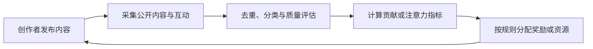

# InfoFi：当信息、注意力和奖励被放进同一个市场

[← 学习总目录](README.md) · [近期热点导航](近期Web3热点导航.md)

> **学习目标**：区分广义信息金融与注意力奖励，读懂 Mindshare、评分和激励设计的局限。
>
> **建议先读**：[SocialFi](SocialFi.md)、[预测市场](预测市场与Polymarket.md)、[AI + Web3](AI%20+%20Web3.md)。
>
> **资料核验**：2026-11-09 已读取 Kaito 官方 Attention Economy 与 Why InfoFi 页面。它们提供项目对该概念的解释，不构成独立的搜索热度或投资价值证明。

展开本篇目录

- [1. InfoFi 有两种常见语境](#section-1)
- [2. 一套注意力激励怎样运转](#section-2)
- [3. Mindshare 应怎样理解](#section-3)
- [4. 奖励池如何影响创作行为](#section-4)
- [5. 怎么区分真实贡献与刷量](#section-5)
- [6. Kaito 是案例，不是 InfoFi 的唯一定义](#section-6)
- [7. 自测与参考答案](#section-7)
- [8. 官方资料与继续搜索](#section-8)

---

## 1. InfoFi 有两种常见语境

广义 InfoFi / Information Finance 关注如何设计市场或激励，让参与者提供有用信息。预测市场通过有成本的判断汇总某类预期，就是一种相关思路。

在部分 Web3 产品语境中，InfoFi 又与注意力、内容贡献、Mindshare 和创作者奖励绑定。平台对内容与互动评分，项目方据此分配资源，参与者因提供信息或吸引关注而获得激励。

**信息质量、传播热度和资产价格是三种不同结果。** 讨论量高不代表观点正确，积分多也不代表拥有确定可兑现的收益。

## 2. 一套注意力激励怎样运转

项目需要内容传播，用户提供时间和观点，平台承担索引与评分。若引入代币或积分，还需要解释谁出资、规则怎样变更、什么行为会被剔除，以及奖励何时结算。

AI 可以帮助分类和分析，但也可能误判讽刺、跨语言内容或专业深度。使用 AI 评分不意味着评价天然客观。

## 3. Mindshare 应怎样理解

Mindshare 常表示某主题在选定信息集合中的关注份额。它必须绑定数据源、时间范围、去重和权重规则，不是全网统一测量单位。

教学例子：在一周筛选后的 10,000 条相关内容中，主题 A 占 1,200 条。按最简单的篇数口径，份额为 12%。如果平台按独立作者或有效互动加权，结果可能完全不同。

这 12% 不是 Google 搜索份额，也不是交易用户占比，更不表示主题 A 的代币应该拥有 12% 市值。

## 4. 奖励池如何影响创作行为

假设项目拿出 10,000 单位预算，按有效贡献积分分配。某用户占最终积分的 1%，在没有额外门槛与上限的简化模型下，分配额为 100。

但最终积分可能在反作弊后改变，预算可能以波动资产支付，领取也可能有资格与期限条件。用户投入 20 小时创作，不意味着系统承诺按小时付款。

当奖励目标过度依赖发帖数，参与者可能优化的是数量；若只奖励正面情绪，又可能削弱独立评价。这是激励设计问题，不能靠把记录上链自动解决。

## 5. 怎么区分真实贡献与刷量

| 观察维度 | 有帮助的信号 | 仍需注意 |
| --- | --- | --- |
| 原创性 | 新事实、分析或可靠引用 | 重写与翻译不一定产生新信息 |
| 传播质量 | 独立受众与持续讨论 | 互动群或机器人可能制造表象 |
| 可核验性 | 证据、预测记录和纠错 | 单次说中可能只是运气 |
| 利益披露 | 清楚说明赞助或持仓 | 披露不等于消除偏见 |
| 规则透明度 | 计分范围、复核和申诉 | 反作弊可能无法完全公开 |

指标一旦成为奖励目标，就容易被刻意优化。更好的系统应允许抽查、申诉和纠错，并避免让单一可刷指标决定全部资源分配。

## 6. Kaito 是案例，不是 InfoFi 的唯一定义

查询时的 Kaito 文档包含信息平台、创作者经济与资本分配等入口，说明产品范围不应被简化为某个旧活动的积分页面。

阅读旧文章中的 Yaps、空投或固定奖励公式时，应回到当前官方规则核对。不要把历史活动承诺套到现在，也不要把项目方对效率和公平的判断当作已经独立验证的结论。

## 7. 自测与参考答案

**问题**：某项目 Mindshare 一周翻倍，为什么不一定意味着真实需求翻倍？

**答案**：可能受到活动补贴、争议新闻、数据源变化或重复内容影响；需要结合独立用户、真实使用和持续性验证。

**练习**：设计一个奖励深度研究的活动，写出计分、反作弊、利益披露与申诉四项规则，避免只奖励发帖数量。

## 8. 官方资料与继续搜索

- [Kaito：Attention Economy](https://docs.kaito.ai/)：官方对注意力经济的定位。
- [Kaito：Why InfoFi](https://docs.kaito.ai/overview/why-infofi)：广义信息金融与项目自身注意力市场叙述。
- **检索词**：`InfoFi`、`information finance`、`Kaito`、`mindshare`、`attention markets`。
- **关注度说明**：本篇作为持续讨论的应用叙事补充，不给出未经验证的月度搜索排名。

---

[← 学习总目录](README.md) · [近期热点导航](近期Web3热点导航.md) · [回到顶部](#top)
