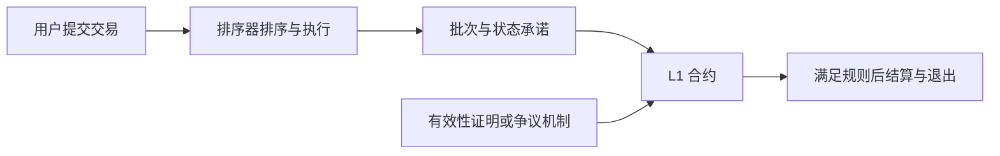

# Layer 2：把执行搬到链外，如何仍由底层验证

[← 返回学习导航](README.md)

> **学习目标**：分清 Rollup、侧链和 Validium，理解排序器确认与最终结算的差别。
>
> **建议先读**：[Layer1](Layer1.md)。

展开本篇目录

- [1. L2 解决什么问题](#section-1)
- [2. Rollup 的数据流](#section-2)
- [3. Optimistic 与 ZK 的差别](#section-3)
- [4. 侧链、Validium 为什么要分开](#section-4)
- [5. 从转入到转出的完整例子](#section-5)
- [6. 如何阅读一个 L2 项目](#section-6)
- [7. 自测与参考答案](#section-7)
- [8. 延伸阅读](#section-8)

---

## 1. L2 解决什么问题

基础层区块空间有限。如果每个用户操作都在 L1 完整执行，费用和吞吐会受到限制。L2 将部分活动移到上层，再通过底层合约、证明或争议机制约束结果。

本篇重点讲 Ethereum Rollup。其他体系的状态通道也常被归入 L2，但工作方式不同，不能把“批量提交数据”的叙述套到所有方案上。

“继承 L1 安全”需要条件：证明机制是否启用、数据能否获取、能否强制退出、管理员能否升级，以及哪些参与者拥有特殊权限。名称带 L2 不等于这些条件全部满足。

## 2. Rollup 的数据流

排序器（Sequencer）负责安排交易顺序，快速反馈有助于体验，但反馈不是最终结算。批次上链、证明被验证或挑战期结束，才是更强的确认阶段。

数据可用性让其他参与者能重建或验证状态。若只有状态根却拿不到必要数据，用户可能无法独立检查或退出。

## 3. Optimistic 与 ZK 的差别

| 维度 | Optimistic Rollup | ZK / Validity Rollup |
| --- | --- | --- |
| 核心思路 | 先接受承诺，允许按协议挑战错误 | 通过有效性证明约束状态转换 |
| 关键参与者 | 排序器、提交者、挑战者等 | 排序器、证明者、验证合约等 |
| 退出等待 | 常受挑战窗口约束 | 受证明生成、提交与 L1 最终性影响 |
| 工程成本 | 争议执行和挑战系统复杂 | 电路、证明系统和执行兼容复杂 |
| 常见误解 | 固定所有项目都等 7 天 | 有证明就能即时到账或默认隐私 |

Arbitrum、OP Stack 体系可以帮助理解乐观路线；ZKsync、Starknet 等可用于理解有效性证明路线。具体项目版本、退出规则与升级权限需要查当前文档。

## 4. 侧链、Validium 为什么要分开

侧链通常依赖自己的验证者和共识。即使把检查点发到 Ethereum，也不自动获得与 Rollup 相同的安全属性。

Validium 使用有效性证明，但把所需数据放在 L1 之外；因此除了证明正确性，还要评估数据可用性提供者。缺数据未必能伪造有效证明，却可能妨碍用户恢复状态和退出。

状态通道让参与者在链下交换签名更新，发生争议时用链上规则处理。它更适合特定参与者和交互形式，不能简单等同于通用 Rollup。

## 5. 从转入到转出的完整例子

假设用户把 100 单位资产从 L1 转到某 Rollup：

1. 在 L1 提交存入交易，等待协议所需确认。
2. L2 识别消息，更新对应余额；这一步不是复制出另一份可重复领取的资产。
3. 用户在 L2 交易，支付 L2 执行成本及相关数据成本。
4. 发起退出，等待该系统规定的证明或争议阶段。
5. 满足条件后，在 L1 领取，可能还需支付领取手续费。

第三方“快速桥”可能先用自己的流动性垫付，因此更快；代价是增加费用、流动性约束和新的对手方或合约风险。

## 6. 如何阅读一个 L2 项目

不要只看费用截图。依次查：交易数据放在哪里、谁能提交或挑战、排序器停机后怎么退出、升级是否有延时、桥与验证合约由谁控制。

治理代币也不一定是 Gas 代币，更不自动赋予公司股权或手续费收益权。技术采用率与代币持有者收益需要分别分析。

## 7. 自测与参考答案

**问题**：钱包显示 L2 交易成功，但 L1 还没有对应批次，矛盾吗？

**答案**：不矛盾。成功可能只是排序器或 L2 执行层的确认；界面应区分 L2 确认与底层结算状态。

**练习**：为跨层提现画出“已发起、等待证明/挑战、可领取、已领取”四个状态，并为每个状态写出依据。

## 8. 延伸阅读

- [跨链桥](跨链桥.md)、[零知识证明](zk.md)。
- [Ethereum 扩容文档](https://ethereum.org/en/developers/docs/scaling/)、[L2BEAT](https://l2beat.com/)（项目配置需按查看日期核验）。

---

[← 返回学习导航](README.md) · [回到顶部](#top)
