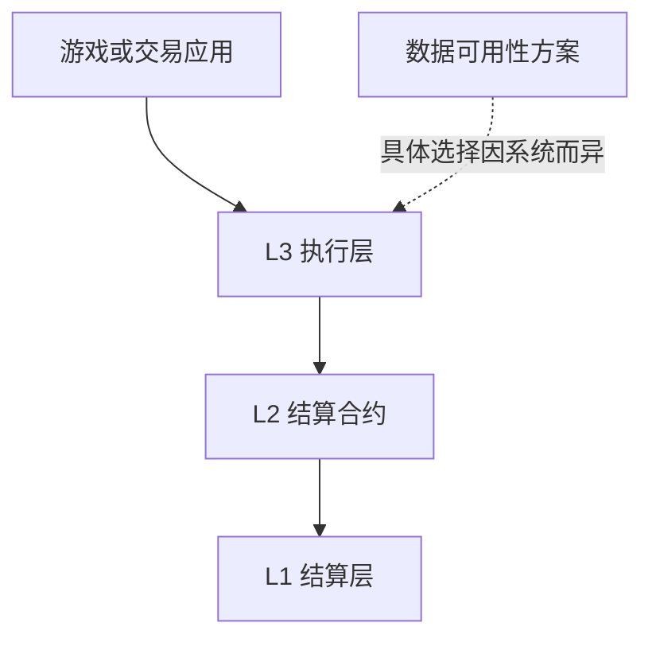

# Layer 3：应用专用层与多层结算

[← 返回学习导航](README.md)

> **学习目标**：理解 L3 的常见技术含义，并区分架构层级、同名产品和预测市场。
>
> **建议先读**：[Layer2](Layer2.md)。

展开本篇目录

- [1. 先消除名称歧义](#section-1)
- [2. 为什么已经有 L2，还需要 L3](#section-2)
- [3. 如何理解多层结构](#section-3)
- [4. L2、L3、应用链怎么选](#section-4)
- [5. 教学案例：预测市场部署在哪一层](#section-5)
- [6. 成本不能只算单笔 Gas](#section-6)
- [7. 自测与参考答案](#section-7)
- [8. 延伸阅读](#section-8)

---

## 1. 先消除名称歧义

Layer 3 没有跨行业完全统一的定义。在扩容语境中，它通常指建立在 L2 之上、服务某类应用或定制需求的执行层；在其他文章里，也可能泛指应用层。

市场上还存在名为 Layer3 的产品或品牌，不能仅凭名字推断其技术架构。**L3 本身不是预测市场协议**，也不必使用条件代币或某个预言机。

原稿中的预测问题、条件代币、订单服务与 UMA 适配器属于另一类业务系统。下面保留这种业务作为应用例子，同时明确它与分层架构的关系。

## 2. 为什么已经有 L2，还需要 L3

设想一款链上游戏：每秒有大量小额操作，希望固定手续费、定制执行环境，并避免与其他应用争抢资源。团队可以考虑部署应用专用层，向上服务游戏，向下通过 L2 结算。

潜在价值包括执行定制、费用策略、应用隔离和证明聚合。但专用链也增加运维、桥接、流动性和钱包适配工作。普通应用如果直接部署在现有 L2 已满足需求，未必需要再加一层。

## 3. 如何理解多层结构

这个图是示意，不能据此假定数据一定逐层完整上链。需要逐项确定：哪一层执行、哪一层验证证明、数据存在哪里，以及用户能否绕过运营者退出。

若 L2 出现停机、升级或结算延迟，依赖它的 L3 可能受到影响。多一层不等于安全性“乘倍增加”，也不意味着最终性比底层更强。

## 4. L2、L3、应用链怎么选

| 选择 | 更适合的需求 | 主要负担 |
| --- | --- | --- |
| 直接在现有 L2 部署合约 | 共享流动性、标准钱包、快速开发 | 与其他应用共享资源 |
| 在 L2 上构建专用 L3 | 需要定制执行或独立费用策略 | 多层结算、桥接和运维 |
| 自主应用链 | 强烈的协议与治理自主需求 | 共识安全和验证者建设 |

应用链是用途分类，L3 是依赖关系分类，两者可以重叠。判断层级时应画出验证和结算依赖，而不是按“专为游戏服务”直接下结论。

## 5. 教学案例：预测市场部署在哪一层

预测市场的核心流程是：定义问题 → 交易结果份额 → 提交结果 → 按争议规则裁定 → 赎回。

例如“某比赛是否按指定时间完成”必须明确结果来源、截止时间、延期规则和争议机制。链上合约可以按结果分配资产，但不能凭空获知现实赛事状态。

这个应用可部署在 L1、现有 L2 或专用层。条件代币、撮合订单、预言机、索引服务描述的是业务模块；它们不能证明系统是 L3。若用户自行建立服务，环境变量也应来自该项目配置，不能沿用来源不明的 SDK 名称和地址。

## 6. 成本不能只算单笔 Gas

假设每月有 100 万次操作，专用层每笔少花 0.001 个计价单位，名义节省为 1,000。但若证明服务、运维和桥接补贴超过 1,000，总成本仍可能增加。

还需考虑故障处理能力、流动性分散，以及从专用层退出回通用层的时间。评估应该包含用户旅程，不只包含执行性能。

## 7. 自测与参考答案

**问题**：一个预测市场支持多链钱包，是否就属于 L3？

**答案**：不是。多链支持是客户端能力；L3 要根据执行、证明和结算依赖关系判断。

**练习**：为“链上小游戏”列出三条必须独立建层才能满足的需求。如果列不出来，优先评估现有 L2 是否足够。

## 8. 延伸阅读

- [Layer1](Layer1.md)、[跨链桥](跨链桥.md)。
- [Arbitrum 官方文档](https://docs.arbitrum.io/)：结合具体链配置学习专用链与结算关系。

---

[← 返回学习导航](README.md) · [回到顶部](#top)
