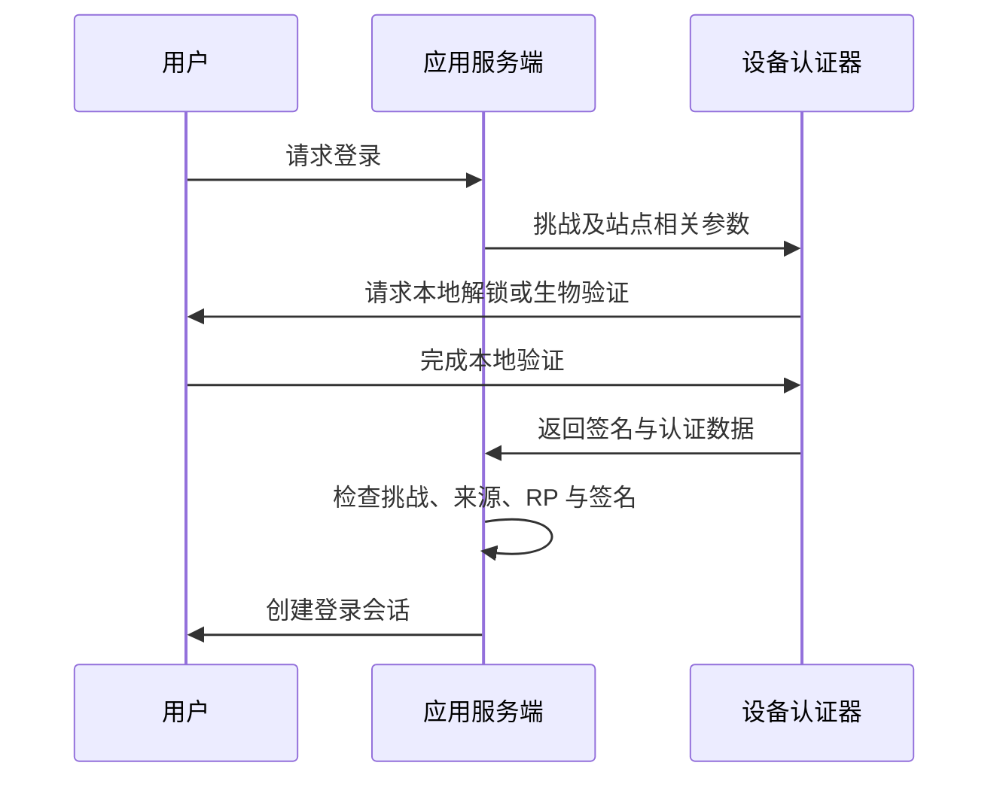

<a id="top"></a>

# Passkey 与嵌入式钱包：免助记词体验背后的权限设计

[← 学习总目录](README.md) · [近期热点导航](近期Web3热点导航.md)

> **学习目标**：区分登录认证、链上签名与账户恢复，理解 Passkey 的工作方式，并能评估嵌入式钱包的控制权。
>
> **前置知识**：[连接钱包](Connectwallet.md)、[账户抽象与 EIP-7702](账户抽象与EIP-7702.md)。
>
> **资料核验：2026-11-09**。WebAuthn Level 3 页面标示为 2026-08-25 的 W3C Recommendation；具体浏览器与钱包支持仍需分别核对。

<details>
<summary>展开本篇目录</summary>

- [1. 两个经常一起出现、却不相同的概念](#section-1)
- [2. Passkey 的基本流程](#section-2)
- [3. 从“已登录”到“能转账”还有一层](#section-3)
- [4. “不用记助记词”不等于“没有恢复问题”](#section-4)
- [5. 一个电商钱包的权限案例](#section-5)
- [6. 怎样判断钱包是否由用户控制](#section-6)
- [7. 自测与参考答案](#section-7)
- [8. 官方资料与检索词](#section-8)

</details>

---


<a id="section-1"></a>

## 1. 两个经常一起出现、却不相同的概念

Passkey 是基于公钥凭证的认证方式，通常通过设备解锁、指纹或人脸验证来完成授权。用户不用输入传统密码，但系统仍然需要验证密码学证据。

嵌入式钱包描述的是钱包融入应用的产品形态：用户可以在应用内创建账户、查看资产和发起操作，而不一定先安装独立钱包扩展。

嵌入式钱包可以使用 Passkey，也可以使用其他登录方式。Passkey 可以用于登录，也可以参与智能账户的授权设计；仅仅“支持 Passkey 登录”并不能证明链上交易由该凭证直接签署。

<a id="section-2"></a>

## 2. Passkey 的基本流程

注册时，认证器创建公钥凭证，服务端保存验证所需的公钥和凭证标识。登录时，服务端发出一次性挑战，认证器在用户完成本地验证后生成可验证响应。



服务端验证的是响应中的密码学证据，而不是收到用户的指纹图片。生物识别通常用于本地解锁认证器，不应描述为把指纹上传区块链。

WebAuthn 凭证与 Relying Party 等站点身份约束相关，有助于降低传统密码钓鱼风险，但无法阻止所有恶意交易或被攻陷应用发起的错误授权。

<a id="section-3"></a>

## 3. 从“已登录”到“能转账”还有一层

| 层次 | 证明或控制什么 | 典型问题 |
| --- | --- | --- |
| 登录认证 | 当前访问者满足账户登录条件 | 挑战是否过期，来源是否正确？ |
| 钱包授权 | 谁能要求钱包签名 | 会话能否直接发起任意交易？ |
| 链上验证 | 交易签名或账户规则是否有效 | 目标链支持哪种签名验证？ |
| 恢复机制 | 凭证丢失后如何重新获得控制 | 谁能替换签名人或导出密钥？ |

一种实现让 Passkey 只负责登录，再由钱包系统管理链上签名；另一种让智能账户验证与 Passkey 相关的签名证据。两者的信任边界不同。

P-256 是常见 Passkey 算法方向之一，但不能假设所有链都原生支持同样的验证路径和成本。链上是否能直接验证、是否需要合约适配，应查目标网络与账户实现。

<a id="section-4"></a>

## 4. “不用记助记词”不等于“没有恢复问题”

同步型 Passkey 可以通过相应账户生态在设备间使用；设备绑定型凭证则可能受单个硬件设备限制。恢复能力取决于具体实现、同步服务和账户安全设置。

对于钱包，还要问更深一层：丢失手机后，是恢复原凭证、增加新签名人、导出钱包密钥，还是由服务商协助重建访问？这些路径影响控制权和可迁移性。

产品应在用户首次入金前，让用户理解自己的恢复途径。好的体验可以隐藏复杂步骤，但不能让用户误以为账户永远不可能丢失。

<a id="section-5"></a>

## 5. 一个电商钱包的权限案例

假设应用允许用户用 Passkey 登录，并授权一个会话每天最多支付 20 USDC，只能调用指定收款合约，7 天后到期。

这组限制需要由可信的签名授权或链上账户规则执行。如果只是前端按钮隐藏了更大金额，攻击者仍可能绕过界面发送请求。

```text
单日额度：20 USDC
本日已使用：14 USDC
本次请求：8 USDC
剩余额度：6 USDC → 应拒绝或请求重新授权
```

实现还需要定义“一天”的时间口径、同时发起两笔请求的竞争处理、已授权但未结算交易如何占用额度，以及撤销后旧会话何时失效。

Passkey 可以帮助确认用户身份，但这些消费约束不会由 Passkey 自动产生。

<a id="section-6"></a>

## 6. 怎样判断钱包是否由用户控制

不能只根据“嵌入式”“MPC”或“无助记词”判断托管性质。应把可能动用资产、恢复账户和改变规则的所有参与者列出来。

| 检查项 | 应当能解释的内容 |
| --- | --- |
| 签名权 | 用户、服务商、设备或多方分别持有什么权限？ |
| 恢复权 | 哪些人能替换凭证，是否存在等待期？ |
| 可迁移性 | 应用停运后，用户如何继续访问资产？ |
| 会话权限 | 是否限定链、合约、金额、期限及撤销方式？ |
| 交易展示 | 用户能否理解收款方、资产与实际授权范围？ |

Passkey 认证成功也不等于用户理解了交易内容。界面仍应解释授权的实际影响，尤其是批量调用、代币授权和长期会话。

<a id="section-7"></a>

## 7. 自测与参考答案

**题目一**：使用指纹登录成功，是否意味着指纹成为链上私钥？

**答案**：不是。指纹通常是本地用户验证手段，密码学操作由认证器中的凭证机制完成。

**题目二**：某应用支持 Passkey，能否直接称它为用户自托管钱包？

**答案**：不能。还要核实签名、恢复、服务商控制和资产迁移机制。

**实践练习**：为“手机丢失”和“应用停运”分别画恢复流程。注明每一步需要哪个账户、设备或服务商；任何无法回答的环节都属于待验证的产品条件。

<a id="section-8"></a>

## 8. 官方资料与检索词

- [W3C WebAuthn Level 3](https://www.w3.org/TR/webauthn-3/)：公钥凭证、认证器、挑战与站点约束。
- [Privy 官方文档入口](https://docs.privy.io/)：嵌入式钱包与认证集成的产品资料入口。

本次 Privy 的特定 Passkey 深层路径返回 404，因此不引用该路径作为接口依据，也不提供未经核对的 SDK 调用。本篇认证机制以 W3C 标准为依据，钱包权限分析保持产品无关。

**检索词**：Passkey 钱包、embedded wallet、WebAuthn P-256、智能账户恢复、session key 权限。

**继续阅读**：[账户抽象与 EIP-7702](账户抽象与EIP-7702.md)，理解认证凭证怎样接到可编程账户规则。

---

[← 学习总目录](README.md) · [近期热点导航](近期Web3热点导航.md) · [回到顶部](#top)
