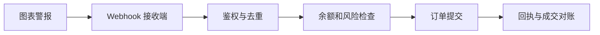

<a id="top"></a>

# TradingView：从看图到可验证的策略信号

[← 返回学习导航](README.md)

> **学习目标**：区分指标、策略回测和实盘执行，理解 Pine Script 与 Webhook 的边界。
>
> **建议先读**：[CEX 现货](CEX-Spot.md)。代码示例使用 Pine Script v6。

<details>
<summary>展开本篇目录</summary>

- [1. 平台提供什么](#section-1)
- [2. 看懂一根 K 线](#section-2)
- [3. Indicator、Strategy 与 Alert](#section-3)
- [4. 一个完整的教学策略](#section-4)
- [5. 怎样阅读回测结果](#section-5)
- [6. Webhook 到实盘的中间层](#section-6)
- [7. 自测与参考答案](#section-7)
- [8. 延伸阅读](#section-8)

</details>

---


<a id="section-1"></a>

## 1. 平台提供什么

TradingView 提供图表、指标、策略测试、警报和部分交易连接能力。图表数据可能来自不同交易所或供应商，同名资产在不同市场的 K 线并不完全相同。

先确认交易所、交易对、现货或合约、时间周期和时区，再分析指标。使用 ETH 的现货信号去交易另一平台永续合约，会引入基差、数据与执行差异。

<a id="section-2"></a>

## 2. 看懂一根 K 线

OHLC 分别是开盘、最高、最低和收盘价，成交量描述该统计窗口内的交易活动。尚未收盘的 K 线会变化，基于它计算的均线、RSI 等也会变化。

“盘中出现信号，收盘时消失”可能是计算方式导致，而不是市场数据被修改。写策略时必须明确用实时柱还是已确认收盘柱。

<a id="section-3"></a>

## 3. Indicator、Strategy 与 Alert

| 工具 | 用途 | 不代表什么 |
| --- | --- | --- |
| Indicator | 计算和绘制指标 | 不自动创建真实订单 |
| Strategy | 通过模拟撮合评估规则 | 不等于真实可成交结果 |
| Alert | 在配置条件下通知或推送 | 不保证外部订单已成交 |
| 交易连接/外部执行器 | 向支持的交易系统执行 | 仍需账户权限与风控 |

不要把图上“买入”箭头直接当成交回执。策略模拟、警报触发和交易所成交应有独立状态。

<a id="section-4"></a>

## 4. 一个完整的教学策略

在 Pine Editor 中新建脚本，粘贴以下代码并添加到图表。它只演示均线交叉与成本参数，不代表获利策略。

```pine
//@version=6
strategy("教学：收盘确认的双均线", overlay=true,
     initial_capital=10000,
     default_qty_type=strategy.percent_of_equity,
     default_qty_value=10,
     commission_type=strategy.commission.percent,
     commission_value=0.1, slippage=2, pyramiding=0)

fastLength = input.int(10, "快线周期", minval=1)
slowLength = input.int(30, "慢线周期", minval=2)
fast = ta.sma(close, fastLength)
slow = ta.sma(close, slowLength)
crossUp = ta.crossover(fast, slow)
crossDown = ta.crossunder(fast, slow)

if barstate.isconfirmed and crossUp
    strategy.entry("Long", strategy.long)
if barstate.isconfirmed and crossDown
    strategy.close("Long")

plot(fast, color=color.orange)
plot(slow, color=color.blue)
```

`commission_value=0.1` 在该设置下表示 0.1%；`slippage=2` 表示两个最小跳动单位，不是 2%。默认模拟执行时点也要查看策略设置，不能假定收盘触发就以同一收盘价成交。

<a id="section-5"></a>

## 5. 怎样阅读回测结果

先检查数据区间和参数，再看费用后的净收益、最大回撤、交易数量与持仓暴露。只看胜率容易忽略“小赚多次、巨亏一次”。

应把数据分为研究与样本外区间，并测试不同市场阶段。反复调整参数直到历史曲线最好，可能只是拟合过去的噪声。

使用高周期数据时注意 `request.security` 的确认语义，避免未来数据泄露。普通 OHLC K 线不能精确反映柱内先后顺序，多次触及止损止盈时尤其需要检查撮合假设。

<a id="section-6"></a>

## 6. Webhook 到实盘的中间层



消息应带策略、市场、方向、K 线时间和唯一事件标识。重复消息、乱序、超时和过期信号需要明确处理；交易密钥应保存在执行端，不放在脚本或警报正文中。

平台警报能力、套餐和授权可能变化，实际限制以当前官方说明为准。本教程不沿用旧套餐名称或“无限警报”等未经核实的承诺。

<a id="section-7"></a>

## 7. 自测与参考答案

**问题**：回测盈利但模拟盘亏损，先检查什么？

**答案**：检查市场和数据源是否一致、信号是否收盘确认、成交时点与深度、费用滑点、重复下单和参数过拟合。

**练习**：在相同参数下分别设置零费用与合理费用，比较收益、回撤和交易次数，解释差异。

<a id="section-8"></a>

## 8. 延伸阅读

- [币安量化脚本](币安量化脚本.md)、[统计套利](统计套利.md)。
- [Pine Script 官方文档](https://www.tradingview.com/pine-script-docs/)、[TradingView 帮助中心](https://www.tradingview.com/support/)。

---

[← 返回学习导航](README.md) · [回到顶部](#top)
