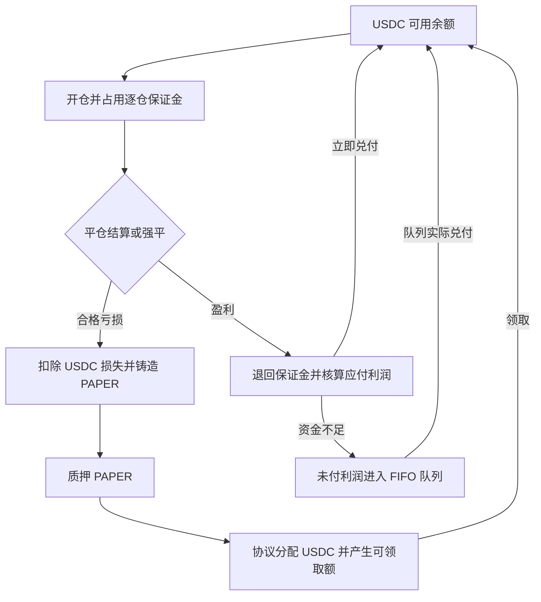

# Papertrade · 从交易亏损到 PAPER 质押与 USDC 分润

[课程首页](../../README.md) · [本阶段](README.md)

> **学完能做到**：追踪一笔亏损如何影响 USDC 保证金、PAPER 发行和质押分润，并复核盈利待兑付的账务状态。

## 先看一个场景

交易者用 USDC 保证金在 Papertrade 开仓。平仓或清算后，符合条件的已实现亏损可以按当时的发行曲线铸造 PAPER。持有人质押 PAPER 后，有资格按份额获得协议实际分配的 USDC。领取的 USDC 可记入 Papertrade 交易余额，因此用户可以用这部分到账资金继续交易。[项目介绍](https://papertrade.finance/docs/intro/what-is-papertrade/) · [质押和领取](https://papertrade.finance/docs/paper/staking/)

站点里还有一节讨论通用模拟盘。Papertrade 是这里介绍的具体协议，仓位和损益使用实际保证金结算。两者适用的学习场景可以在相邻课程对照。[Paper Trading 模拟交易](19-paper-trading.md)

## 资金流与四类余额

| 账面项目 | 何时增加 | 如何核对 |
| --- | --- | --- |
| 可用 USDC | 充值、仓位释放保证金、利润兑付、领取分润 | 交易余额及每笔到账记录 |
| 仓位保证金 | 开仓时从可用余额转入 | 仓位 ID、抵押金额和强平价 |
| PAPER 余额及质押量 | 合格亏损触发铸造后可质押，也可解除质押 | 铸造、质押、解押分开记账 |
| 应收 USDC | 分润应计或盈利平仓后等待兑付 | 将待领质押收益与队列利润分开，两笔款项各自到账后更新可用余额 |

## 开仓、平仓与清算

Papertrade 的交易逻辑运行在 HyperEVM，合约读取 Hyperliquid HyperCore 的最佳买价和卖价，用两者的中间价作为定价参考。仓位的对手方是协议 LP。开仓前需要校验保证金、仓位限制和方向敞口。所选杠杆乘以逐仓保证金得到名义敞口。盈利平仓可能经过非对称影响调整，具体已实现损益以协议结算为准。触及强平条件时，逐仓保证金可被全部扣除。[交易与定价](https://papertrade.finance/docs/learn/trades-pricing/) · [盈亏结算](https://papertrade.finance/docs/learn/wins-losses/) · [清算](https://papertrade.finance/docs/learn/liquidations/)

| 交易结果 | USDC 账务 | PAPER 账务 |
| --- | --- | --- |
| 自愿亏损平仓 | 扣除实际亏损，剩余保证金回到可用余额 | 按合格亏损基数铸造 |
| 触发强平 | 按强平规则扣除逐仓保证金并结束仓位 | 合格清算损失参与发行 |
| 盈利平仓 | 保证金回到可用余额，调整后的利润视 LP 可支付额立即到账或排队 | 该盈利本身不产生亏损发行 |

### 如何读一笔仓位

假设合约读到的买一是 99,990，卖一是 100,010，参考中间价就是 100,000。用 100 USDC 保证金开 10 倍多仓，名义敞口为 1,000 USDC。价格涨到 102,000，理论毛盈亏约为 20 USDC。应付利润还要经过协议的盈利调整和结算。价格跌到 98,000，且仓位仍可正常平仓时，理论毛亏损约为 20 USDC。计算使用的是**开仓名义额乘以价格变化比例**。是否强平要另外读取实际 bust price，清算单也有独立的结算规则。[交易与定价](https://papertrade.finance/docs/learn/trades-pricing/) · [盈亏结算](https://papertrade.finance/docs/learn/wins-losses/) · [清算](https://papertrade.finance/docs/learn/liquidations/)

官方文档描述的协议通常按中间价定价，使用方向敞口与仓位数量等限制管理风险。比较实际结果时，可逐项核对价格变动、盈利调整后的应付金额、已兑付金额和待兑付金额。[交易与定价](https://papertrade.finance/docs/learn/trades-pricing/)

## PAPER 如何增发

官方文档给出的早期发行区间是跟踪 LP 低于 200 万美元时，每 1 美元合格亏损基数铸造 100 PAPER。达到阈值后，发行率随累计进度的高水位下降。后来 LP 余额下降，先前已推进的发行曲线进度也会保留。合格基数由结算规则决定，可能与页面展示的总亏损不同，应以实际铸造事件为准。[PAPER 发行](https://papertrade.finance/docs/learn/paper-emissions/) · [发行曲线](https://papertrade.finance/docs/how/mint-curve/)

可用下面的公式理解发行曲线。进入衰减区间后，发行率为 `flatRate × (S / (S + H))²`。其中 `S` 是协议配置的衰减尺度，`H` 是后续阶段的累计高水位进度。用相对值做教学演算，当 `H = S` 时，发行率是早期速率的四分之一。同样 30 美元的合格亏损基数，在每美元 100 PAPER 时铸造 3,000 PAPER，在每美元 25 PAPER 时铸造 750 PAPER。协议文档描述其初始供给为零，后续供给由合格结算产生。[发行曲线](https://papertrade.finance/docs/how/mint-curve/) · [PAPER 代币经济](https://papertrade.finance/docs/paper/overview/)

## U 怎么回到交易余额

质押后，账户按自己占当次有效质押池的比例参与分配。官方文档列出的 USDC 来源包括 LP 侧结算收入中的指定份额，以及达到条件后可分配的 LP 超额资金。解除质押返还 PAPER，领取奖励则把已累积的 USDC 记入交易账户。两种操作各有独立的记账事件。质押规模相同的账户，遇到总质押量上升时，分得的比例也会下降。[质押分润](https://papertrade.finance/docs/learn/staking-dividends/) · [质押和领取](https://papertrade.finance/docs/paper/staking/)

假设某账户用 100 USDC 开仓，亏损平仓损失 40 USDC。忽略其他变动，剩余 60 USDC 回到可用余额。如果该笔结算给出的合格亏损基数为 30 美元且发行率为 100，则铸造 3,000 PAPER。用户把这些 PAPER 全部质押，某一轮分配时池内共有 300,000 PAPER，协议实际分配 600 USDC，账户应计 6 USDC，领取后可用余额变为 66 USDC。这笔交易产生的 40 USDC 损失仍在交易账本中，6 USDC 另记质押分润。如果当期分配额为 0，同样的持仓份额在该期新增的 USDC 也是 0。

### 从已实现亏损到下一笔可用保证金

| 动作 | 可用 USDC | 仓位保证金 | 钱包 PAPER | 已质押 PAPER | 可领取分润 |
| --- | ---: | ---: | ---: | ---: | ---: |
| 转入示例资金 | 100 | 0 | 0 | 0 | 0 |
| 开仓 | 0 | 100 | 0 | 0 | 0 |
| 亏损平仓并结算发行 | 60 | 0 | 3,000 | 0 | 0 |
| 质押 | 60 | 0 | 0 | 3,000 | 0 |
| 协议实际分配一轮 | 60 | 0 | 0 | 3,000 | 6 USDC |
| 领取一轮分润 | 66 | 0 | 0 | 3,000 | 0 |

文档描述的奖励记账使用单位质押累计奖励。协议分配时，用本轮实际分配量除以当时的有效质押量。账户随后按各段持仓累积应得奖励。加仓或解押时要先结算旧持仓期间的奖励，再更新参与下一轮的数量。这样，刚质押的 PAPER 从本次入池开始累计，之前已经产生的分润仍归原质押者。[质押和领取](https://papertrade.finance/docs/paper/staking/)

## 盈利排队怎么记账

如果协议不能立即支付已结算的利润，未付部分可以进入先进先出队列。仓位保证金按平仓规则单独退回。假设有 50 USDC 可退保证金和 20 USDC 已确认利润，协议当前只能支付 8 USDC 利润。账户此时增加 58 USDC 可用余额，并另记 12 USDC 待兑付利润。待兑付额要等队列实际支付才能进入可用余额。查看队列长度时，还应同时核对 LP 流动性和未平仓敞口。[盈利兑付队列](https://papertrade.finance/docs/learn/lp-queue/) · [LP 账务](https://papertrade.finance/docs/how/solvency-queue/)

队列中同时有 A 待领 12 USDC 和 B 待领 7 USDC，A 排在前面。若本轮新增资金只够付 10 USDC，则按教学 FIFO 模型先支付 A 10，A 余 2，B 仍余 7。下一轮有 5 USDC，可先结清 A，再支付 B 3。前端需要同时显示累计兑付、剩余应收与可用余额。官方文档将常规 LP 余额、队列活跃时暂存的资金及队列欠款分别记账。[LP 账务](https://papertrade.finance/docs/how/solvency-queue/)

## 产品页面怎么设计

| 页面 | 需要同时显示的字段 | 状态变化如何呈现 |
| --- | --- | --- |
| Trade | 价格参考、保证金、名义敞口、预计强平价 | 签名、提交、开仓确认、拒单和结算分开显示 |
| Portfolio | 可用 USDC、占用保证金、已实现盈亏、待兑付利润 | 盈利确认后分开显示即时到账和待付队列金额 |
| Staking | 钱包 PAPER、已质押 PAPER、应计 USDC、已领取 USDC | 质押和领取各自跟踪交易确认和余额变动 |
| House | LP 余额、方向敞口、队列欠款及近期兑付 | 用同一时点的数据核对新增债务和实际兑付 |

复盘项目经济性时，可以把资金流拆成交易损益、协议结算收入和质押分配，再分别观察三种状况。交易活跃度下降时查看实际分润。总质押量上升时重新计算个人份额。未平仓敞口偏向一侧时，应结合队列规模看已有债务和新增付款压力。PAPER 的市场估值也可以单列，实际领取的 USDC 以账本为准。[协议介绍](https://papertrade.finance/docs/intro/what-is-papertrade/) · [质押分润](https://papertrade.finance/docs/learn/staking-dividends/) · [盈利兑付队列](https://papertrade.finance/docs/learn/lp-queue/)

本文的机制依据是协议官方公开文档，账例使用教学数据。具体参数和生效区间以相应结算时的配置与回执为准。

## 动手练习

用教学数据复盘一笔亏损平仓、一笔清算和一笔盈利排队。为每笔记录仓位 ID、已实现 USDC 损益、合格亏损基数、PAPER 铸造量、已质押 PAPER、应计 USDC、实际领取额和待兑付利润。用同一事件重复投递两次，验证余额和发行记录只入账一次。

## 自测

质押比例为 1%，前后两轮各分配 600 USDC，第二轮前总质押量翻倍且个人质押量不变。两轮累计能领取多少？

查看参考答案

第一轮分得 6 USDC。第二轮个人占比降到 0.5%，分得 3 USDC。两轮合计 9 USDC。领取金额来自协议实际分配，和原交易的亏损金额分别核算。

---

[上一课 · 预测市场 · 开盘、争议和兑付](20-prediction-market-operations.md) · [下一阶段 · 应用、治理与商业模式](../08-applications/README.md)
