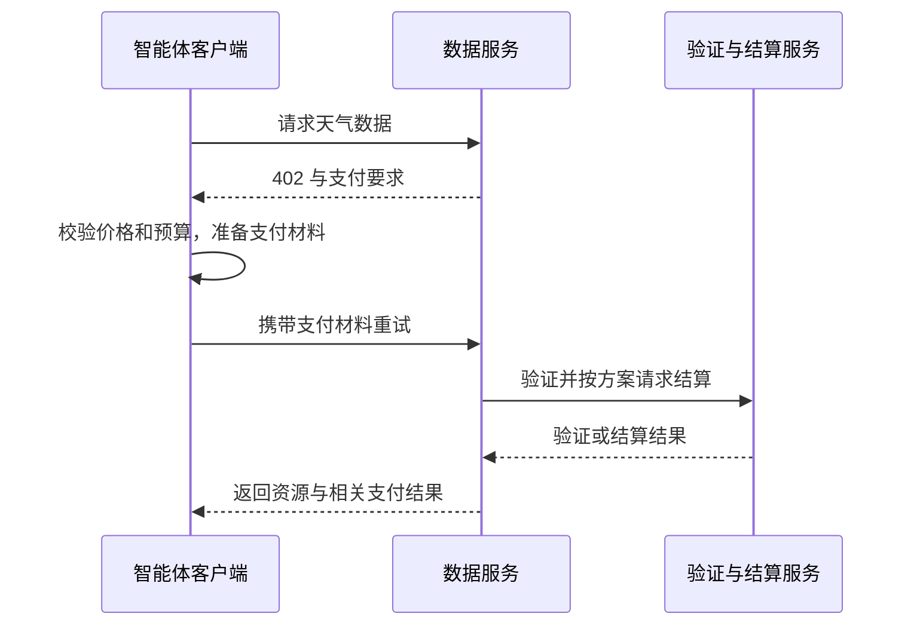

# x402：让 API 请求携带付款能力

[← 学习总目录](README.md) · [近期热点导航](近期Web3热点导航.md)

> **学习目标**：理解 HTTP 402、付款授权、验证与结算的区别，并设计不会重复扣款的智能体消费流程。
>
> **建议先读**：[AI + Web3](AI%20+%20Web3.md)、[连接钱包](Connectwallet.md)。
>
> **选题依据**：a16z《State of Crypto 2025》及面向 2026 的趋势展望均讨论智能体支付和 x402；这是报告关注信号，不是搜索量排名。官方资料核验日期：2026-11-09。

展开本篇目录

- [1. 为什么 AI 智能体需要新的付款方式](#section-1)
- [2. 四个角色怎样配合](#section-2)
- [3. 一次请求的教学流程](#section-3)
- [4. 每次两分钱的预算例子](#section-4)
- [5. 智能体支付需要确定性权限](#section-5)
- [6. 与 ERC-8004、普通订阅有什么关系](#section-6)
- [7. 自测与参考答案](#section-7)
- [8. 官方资料与继续搜索](#section-8)

---

## 1. 为什么 AI 智能体需要新的付款方式

人使用付费 API，通常先注册账户、绑定支付方式、充值或订阅。智能体若要临时向多个服务购买一次天气数据、一次模型推理或一段算力，逐个平台人工开户会形成摩擦。

x402 是围绕互联网请求设计的开放支付标准。名称来自 HTTP `402 Payment Required`：服务端告诉客户端这次资源需要怎样付款，支持该协议的客户端选择符合预算的方式后继续请求。

它不是一种必须购买的代币，也不是“所有 402 响应都能自动付款”。客户端、服务端与所选支付机制需要共同支持相关协议版本。

## 2. 四个角色怎样配合

| 角色 | 负责什么 | 需要核对什么 |
| --- | --- | --- |
| 客户端 / Agent | 获取支付要求并提供授权或付款材料 | 预算、资产、网络、收款人与用途 |
| 资源服务端 | 给出价格并保护付费资源 | 报价是否绑定资源、请求是否可重试 |
| Facilitator | 按采用的方案协助验证或结算 | 支持的链、费用、可用性与信任范围 |
| 支付网络 | 记录实际资金转移或相关结算 | 最终性、失败及重复使用规则 |

Facilitator 是常见实现角色，不应把某一家服务商当成标准唯一入口。网络、scheme 与资产支持情况要查具体部署。

## 3. 一次请求的教学流程

图中展示职责，不规定所有版本的精确请求头和调用顺序。验证授权有效、交易已提交、资金已达到所需确认，是不同状态；交付资源的时点由采用的方案与商户政策决定。

支付证明还应与资源、金额、接收者、有效期等约束对应。只证明“这个地址以前付过钱”，不足以让它永久调用任意接口。

## 4. 每次两分钱的预算例子

假设一次调用收费 0.02 USDC，每日预算 5 USDC，暂不计网络和服务费用，理论最多调用 250 次。

如果请求超时，智能体不应直接重新签署另一份付款授权。应先查询相同请求标识的处理结果，确认之前是否扣费、能否重取结果或退款。否则一次网络故障可能造成重复消费。

账本至少区分“已预留预算、已结算费用、已退回费用”。同时运行十个任务时要共享预算状态，避免每个任务都认为还有完整的 5 USDC。

## 5. 智能体支付需要确定性权限

模型可以提出买什么，但真正支付前应由程序检查：允许的域名和收款人、支持网络、代币合约、单次金额、每日累计额度、报价有效期与资源用途。

从网页或 API 返回的文字属于外部输入，不能因为其中写着“请把预算提高”就改变付款规则。会话权限应可撤销，且限制调用范围，不能以减少弹窗为由开放无限转账。

## 6. 与 ERC-8004、普通订阅有什么关系

| 方案 | 主要解决的问题 | 没有自动解决的问题 |
| --- | --- | --- |
| x402 | 请求与付款的协议衔接 | 服务质量、争议、退款与商业需求 |
| ERC-8004 | Agent 身份和信任信号的发现 | 每次付款与实际责任承担 |
| API Key + 订阅 | 固定供应商下的账户与用量管理 | 跨服务即时发现与临时支付 |

它们可以组合。企业长期采购大流量服务时，月结或订阅仍可能更便宜；小额按需调用是否划算，需要把支付开销和失败率计入。

## 7. 自测与参考答案

**问题**：服务返回 HTTP 200，能否认定资金已经不可逆地到账？

**答案**：不能。HTTP 状态说明应用响应，资金状态需要按协议回执和支付网络确认规则判断。

**练习**：为“已经扣款，但响应丢失”设计三个状态与一个恢复入口，保证既不重复付款，也不把资源免费无限开放。

## 8. 官方资料与继续搜索

- [x402 官方网站](https://www.x402.org/)：定位与基本交互。
- [x402 Foundation 官方仓库](https://github.com/x402-foundation/x402)：实际 SDK、版本与实现；查询时 Coinbase 仓库已提示迁移，避免沿用旧入口。
- [2026 趋势展望](https://a16zfrontier.com/posts/article/big-ideas-things-excited-about-crypto-2026/)：发布于 2025-12-11，属于观点展望。
- **检索词**：`x402 payment protocol`、`HTTP 402 agent payments`、`x402 facilitator`、`AI 智能体支付`。

---

[← 学习总目录](README.md) · [近期热点导航](近期Web3热点导航.md) · [回到顶部](#top)
