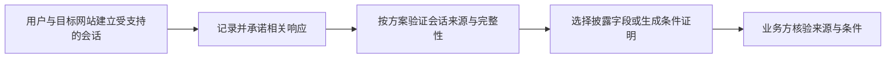

# zkTLS：怎样证明网页返回过什么，而不交出全部隐私

[← 学习总目录](README.md) · [近期热点导航](近期Web3热点导航.md)

> **学习目标**：理解 TLS 会话、来源证明、选择性披露与业务真实性的区别，判断链下数据如何进入链上决策。
>
> **建议先读**：[零知识证明](zk.md)、[GraphQL](GraphQL.md)、[隐私计算与 FHE](隐私计算与FHE.md)。
>
> **资料核验**：2026-11-09 已读取 TLSNotary 官方仓库。其当前 README 明示实现仍在积极开发、不应用于生产；本文提供机制教学，不给出可直接上资金业务的结论。zkTLS 是一类技术路线的统称，不是唯一协议。

展开本篇目录

- [1. 为什么一张截图不够](#section-1)
- [2. TLS 为什么不能直接充当网页签名](#section-2)
- [3. 一次资格证明的流程](#section-3)
- [4. 来源真实不等于现实事实真实](#section-4)
- [5. 三个最容易遗漏的约束](#section-5)
- [6. 与传统预言机有什么关系](#section-6)
- [7. 自测与参考答案](#section-7)
- [8. 官方资料与继续搜索](#section-8)

---

## 1. 为什么一张截图不够

假设你要证明自己在某网站拥有一张有效会员凭证，但不想公开姓名、完整账户信息和所有历史记录。截图容易被修改；把登录密码交给验证方则泄露了过多权限。

zkTLS 相关方案尝试让第三方验证某段数据来自特定 TLS 会话，并在适当机制下只披露需要的信息。不同方案可能使用 MPC、零知识证明、公证参与者或其他结构，信任假设并不相同。

名字带 zk，不代表所有阶段都只是纯零知识算法，也不意味着完全没有可信参与者。

## 2. TLS 为什么不能直接充当网页签名

HTTPS 保护客户端与服务器之间的通信，但它不是把每一段响应都变成任何第三方可以独立验证的服务器公开签名。会话中的密钥与认证机制需要按照 TLS 的模型理解。

因此，简单保存响应正文或会话日志再上传，通常不能解决第三方可验证性。相关协议需要设计会话建立、承诺、协作和证明，使用户不能随意伪造想披露的服务器数据。

## 3. 一次资格证明的流程

例如只证明“会员等级至少为指定值”，隐藏姓名与其他字段。验证方还要知道网站域名、数据结构、获取时间和所采用的验证方案，不能只收到一个不明来源的 proof 字符串。

若最终要触发链上资产操作，还需要相应的链上验证器或可信数据接入流程。浏览器中验证通过，不会自动变成链上共识。

## 4. 来源真实不等于现实事实真实

| 已证明的事情 | 仍然没有证明的事情 |
| --- | --- |
| 特定服务器返回了这段记录 | 服务器的记录一定正确 |
| 数据符合规定结构 | 该账户没有被盗用 |
| 某字段达到门槛 | 用户没有其他负债或限制 |
| 某个时点的状态有效 | 现在仍然有效 |

银行网站曾显示余额 10,000，不等于用户此刻还持有 10,000，也不等于资产没有被冻结或被重复用于多个担保。真实信贷和抵押场景需要更完整的账户、时间和负债信息。

## 5. 三个最容易遗漏的约束

**语义绑定**：证明的是哪个账户、哪个接口、哪种货币和哪个字段？同一个数字在不同上下文下意义完全不同。

**时效与重放**：验证方应根据风险设置时间窗口，并在需要时绑定一次性挑战或业务动作。不能把一年前的证明当成实时资格。

**披露边界**：隐藏字段后，公开部分、请求路径、时间和账户行为仍可能泄露身份。证明文件、日志和调试截图都需要控制暴露范围。

## 6. 与传统预言机有什么关系

传统预言机常把价格或事件等数据发布给很多应用；zkTLS 类方案可以帮助证明某个用户与某个网站交互得到的数据。两者可以互补，不能简单说后者让前者全部失去意义。

如果应用需要持续、统一、抗异常的数据流，还要处理采样频率、异常源、更新成本和可用性。单份来源证明没有自动完成这些工作。

## 7. 自测与参考答案

**问题**：证明网站返回“已完成课程”，是否自动意味着现实中的同一个人参加了所有学习活动？

**答案**：不是。它证明的主要是来源与记录，还需要核验账户控制、人和账户的关系，以及网站本身的认证规则。

**练习**：为“证明自己有某会员资格但不暴露姓名”写出需要公开的最少字段、有效期和必须信任的参与者。

## 8. 官方资料与继续搜索

- [TLSNotary 官方仓库](https://github.com/tlsnotary/tlsn)：MPC 相关定位、开发状态与版本建议。
- [TLSNotary 文档入口](https://tlsnotary.org/docs/intro)：继续学习具体方案，评估时固定版本。
- **检索词**：`zkTLS`、`TLSNotary`、`MPC-TLS`、`selective disclosure`、`web data provenance`。
- **关注度说明**：本篇按数据可信与隐私主题的知识缺口补充，未取得该关键词的独立搜索排名。

---

[← 学习总目录](README.md) · [近期热点导航](近期Web3热点导航.md) · [回到顶部](#top)
