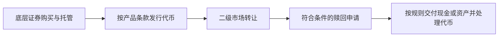

# 代币化股票：拿到链上代币，是否就成为公司股东

[← 学习总目录](README.md) · [近期热点导航](近期Web3热点导航.md)

> **学习目标**：区分股票权利、经济敞口和合成衍生品，理解托管、赎回、分红与交易时段。
>
> **建议先读**：[RWA](RWA.md)、[Perp DEX](PerpDEX与Hyperliquid.md)、[稳定币支付](稳定币支付与PayFi.md)。
>
> **资料核验**：2026-11-09 已读取 xStocks 官方文档与 Kraken 的 xStocks FAQ；后者标注更新于 2026-10-30。本篇用具体案例解释权利边界，不把它推广为所有代币化证券的统一法律结构。

展开本篇目录

- [1. 先问代币代表什么](#section-1)
- [2. 三种结构的区别](#section-2)
- [3. 资产支持型产品的生命周期](#section-3)
- [4. xStocks 案例说明了什么](#section-4)
- [5. 周末交易为什么可能偏离参考价](#section-5)
- [6. 分红、拆股与数量变化](#section-6)
- [7. 自测与参考答案](#section-7)
- [8. 官方资料与继续搜索](#section-8)

---

## 1. 先问代币代表什么

Tokenized Stocks / Equities 通常指与股票或 ETF 权益、价值相关的链上代币。但不同产品可能代表直接登记的证券权利、对发行结构的合同请求权，或仅仅是合成价格敞口。

名称里出现某公司股票代码，不意味着公司亲自发行该代币，也不自动赋予投票、分红或破产程序中的同等地位。

判断的第一步应是阅读“谁是发行方、底层资产由谁持有、持有人拥有什么可执行权利”。

## 2. 三种结构的区别

| 结构 | 经济关系 | 核心核查问题 |
| --- | --- | --- |
| 证券本身采用代币化登记 | 代币与证券权利按法律结构对应 | 登记、转让限制与股东权利 |
| 有资产支持的价值凭证 | 通过发行与托管结构跟踪底层价值 | 托管、担保、兑付和发行方义务 |
| 合成价格敞口 | 由衍生品或其他机制跟踪价格 | 抵押、预言机、资金费与对手方 |

不能把某一种结构的优势套到其他结构上。例如“没有到期日”不等于没有融资成本，“1:1 支持”也不等于持有人在所有情况下都能直接提走股票。

## 3. 资产支持型产品的生命周期

发行、二级市场交易和赎回可能由不同参与方处理，并有不同营业时间、资格和费用。区块链转账成功，只证明链上状态变化，不证明底层托管已经完成全部对账。

## 4. xStocks 案例说明了什么

查询时，xStocks 文档描述了以底层股票或 ETF 支持的代币化产品；Kraken FAQ 明确说明其 xStocks 不赋予股东投票等直接股东权利，股息经济利益通过相关调整机制传递，而不是直接现金股息权利。

这说明“跟踪股票价值”与“持有普通经纪账户中的股票”存在重要差异。具体产品是否允许某种赎回、参与者是否有资格、如何处理公司行动，都要按当期条款确认。

本文不复制可快速过时的地区名单、合约地址或发行数量，也不使用营销页面的覆盖描述推断某个用户必然可以参与。

## 5. 周末交易为什么可能偏离参考价

假设某股票最后常规成交价为 100，周末链上凭证的卖盘报价为 103。若底层市场尚未开放、赎回或对冲受限，套利者未必能立即消除这 3% 偏离。

买入 10 份的账面成本为 1,030，但不能因参考价 100 就认定买到或卖出一定有套利机会。需要考虑盘口、发行赎回、交易时间、资金成本和下一次开市的价格跳空。

**全天可交易不等于全天同样有深度，也不等于底层市场、发行与赎回全天开放。**

## 6. 分红、拆股与数量变化

在一个简化的经济权益例子中，持仓价值 100，收到价值 1 的股息再投资，按同一参考价可对应额外 0.01 份权益。实际产品可能通过 rebase、权益比例或其他方式处理，且要计费用与税务因素。

拆股也会改变数量与单位价格，但不因数量增加自动创造收益。钱包和账本应理解产品的公司行动机制，不能把所有余额增加都记成新增存款。

## 7. 自测与参考答案

**问题**：链上代币有足额资产支持，是否意味着没有发行方或托管风险？

**答案**：不是。仍需检查储备真实性、资产隔离、可执行请求权、托管安排和退出条件。

**练习**：为一个代币化股票产品填一张权利表：投票、股息、赎回、转让、冻结和破产处理，无法确认的字段保留为未知。

## 8. 官方资料与继续搜索

- [xStocks 官方文档](https://docs.xstocks.fi/docs)：产品机制、发行赎回与公司行动入口。
- [Kraken xStocks FAQ](https://support.kraken.com/articles/xstocks-faq)：本次读取到的页面更新日期为 2026-10-30，含股东权利与股息说明。
- **检索词**：`tokenized stocks`、`tokenized equities`、`xStocks shareholder rights`、`onchain securities`、`股票代币化`。
- **关注度说明**：RWA 与代币化是公开行业报告的关注方向；本文不虚构当前股票代币搜索排名。

---

[← 学习总目录](README.md) · [近期热点导航](近期Web3热点导航.md) · [回到顶部](#top)
