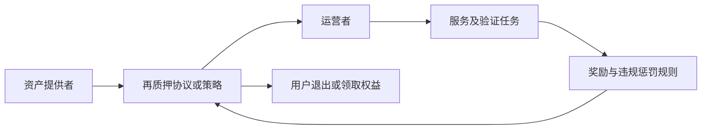

# 再质押 Restaking 与 LRT：额外收益对应哪些额外承诺

[← 学习总目录](README.md) · [近期热点导航](近期Web3热点导航.md)

> **学习目标**：分清 Staking、LST、Restaking 和 LRT，理解惩罚、收益与退出路径如何叠加。
>
> **建议先读**：[Layer1](Layer1.md)、[DeFi](DeFi.md)、[风险控制与监控](风险控制与监控.md)。
>
> **选题定位**：持续受到讨论的基础设施延伸课，不宣称为本月新概念或搜索榜前列。2026-11-09 已读取 EigenLayer 官方合约仓库资料。

展开本篇目录

- [1. 为什么叫“再”质押](#section-1)
- [2. 四个概念一张表](#section-2)
- [3. 参与者怎样连接](#section-3)
- [4. 收益叠加的教学例子](#section-4)
- [5. 退出为什么可能变慢](#section-5)
- [6. 风险为什么会相关](#section-6)
- [7. 自测与参考答案](#section-7)
- [8. 官方资料与继续搜索](#section-8)

---

## 1. 为什么叫“再”质押

PoS 质押通常把资产用于支持某个网络的验证责任，并按规则获得收益或承担惩罚。再质押让资产进一步支持其他服务的可验证承诺，例如由运营者承担额外工作与违规惩罚。

它不是复制出两份本金，也不是把同一资产无成本地抵押无数次。增加服务承诺，就需要明确哪些行为可被惩罚、谁判定、能损失多少以及退出如何生效。

## 2. 四个概念一张表

| 概念 | 含义 | 用户拿到或承担什么 |
| --- | --- | --- |
| Staking | 支持某网络的验证职责 | 质押收益与网络惩罚风险 |
| LST | 流动性质押凭证 | 对质押资产的协议权利与流动性 |
| Restaking | 让资产支持额外服务承诺 | 额外收益机会与额外责任 |
| LRT | 流动性再质押凭证 | 对再质押策略的权利及其组合风险 |

LST 或 LRT 的二级市场价格不一定等于其会计兑换价值；“可交易”也不意味着能随时按面值赎回。

再质押也不必全部通过 LRT 完成。有的用户直接参与协议，有的通过第三方策略和凭证间接参与。

## 3. 参与者怎样连接

EigenLayer 资料描述 Restaker、Operator 与 AVS 等角色。AVS 在不同阶段资料中的全称可能不同，阅读时以所用版本为准；更关键的是弄清该服务做什么，以及什么行为会影响担保资产。

不能只凭“借用 Ethereum 安全”就认定某个服务获得与 Ethereum 完全相同的安全保证。实际担保规模、运营者集合、惩罚机制和依赖都需要单独看。

## 4. 收益叠加的教学例子

假设某策略按同一计价基准展示基础收益 3%、额外服务收益 2%，用户不能直接把它理解为未来确定获得 5%。还需考虑服务费、收益币种、实际启用时间与惩罚损失。

例如价值 10,000 的头寸，一年实际获得基础收益 300、服务收益 200，扣费 50，但发生 400 的损失，净结果只有 50，约为 0.5%。如果底层资产本身价格下跌，按法币计价的结果还会不同。

积分、空投预期和代币奖励，应与已实现现金流分开。未承诺兑换价值的积分不能直接计作资产收益。

## 5. 退出为什么可能变慢

从 LRT 回到原资产，可能经历凭证赎回、策略退出、再质押等待和底层质押退出。市场上直接卖出 LRT 可能更快，但需接受实际盘口价格与滑点。

退出等待用于保留对历史行为的处理空间或满足底层协议规则，具体期间依协议变化。不能把“发起提现”写成“资产已经可用”。

## 6. 风险为什么会相关

同一运营者为多个服务工作，软件故障或密钥问题可能同时影响它们。多个 LRT 也可能使用相同底层协议、运营者或质押凭证，表面分散不一定减少相关风险。

还要检查升级权限、策略选择权限、惩罚参数和服务切换机制。用户买的是一条完整依赖链，不只是一个年化数字。

## 7. 自测与参考答案

**问题**：持有 LRT 比直接质押多一层收益，为什么可能还少赚？

**答案**：费用、市场折价、额外惩罚和退出成本可能超过新增收益，且收益本身不固定。

**练习**：为一个假想 LRT 画出资产、凭证、运营者和服务四层，标出每层谁能暂停或改变规则。

## 8. 官方资料与继续搜索

- [EigenLayer 官方合约仓库](https://github.com/Layr-Labs/eigenlayer-contracts)：已读取其 Restaking、角色与惩罚承诺说明；不把仓库版本视为所有第三方策略的部署版本。
- **检索词**：`restaking`、`liquid restaking token LRT`、`EigenLayer AVS`、`slashing allocation`、`再质押风险`。

---

[← 学习总目录](README.md) · [近期热点导航](近期Web3热点导航.md) · [回到顶部](#top)
