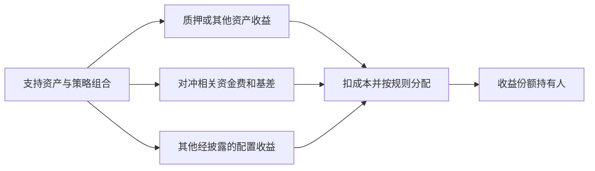

<a id="top"></a>

# 合成美元与收益型稳定币：USDe、sUSDe 和收益来源

[← 学习总目录](README.md) · [近期热点导航](近期Web3热点导航.md)

> **学习目标**：区分法币储备稳定币、合成美元与收益凭证，理解对冲如何降低方向敞口，并识别收益的来源和变化原因。
>
> **前置知识**：[稳定币支付与 PayFi](稳定币支付与PayFi.md)、[现货—合约套利](现货-合约套利.md)。
>
> **资料核验：2026-11-09**。以 Ethena 官方资料为产品案例；资产配置与规则会变化，教学模型不代表当前全部储备。

<details>
<summary>展开本篇目录</summary>

- [1. 名字里都有“美元”，底层机制可能不同](#section-1)
- [2. USDe、sUSDe 与 ENA](#section-2)
- [3. Delta 中性到底“中性”在哪里](#section-3)
- [4. 收益是从哪里来的](#section-4)
- [5. 收益算例：正资金费变负会怎样](#section-5)
- [6. 四个与“价格中性”不同的风险](#section-6)
- [7. 自测与参考答案](#section-7)
- [8. 官方资料与检索词](#section-8)

</details>

---


<a id="section-1"></a>

## 1. 名字里都有“美元”，底层机制可能不同

法币储备型稳定币通常依赖发行方持有的现金或其他储备，以及相应赎回安排。合成美元则可能通过资产组合与衍生品对冲构造接近美元的价值敞口。

Ethena 将 USDe 描述为 synthetic dollar，即合成美元，并明确提示其与 USDC、USDT 等法币稳定币的机制不同。理解这一差异，比只比较交易价格是否接近 1 美元更重要。

收益型稳定币也不是统一的技术标准。产品可能让余额增长、让份额净值增长，或要求用户另行质押获得收益凭证。必须读清收益到底归谁。

<a id="section-2"></a>

## 2. USDe、sUSDe 与 ENA

| 名称 | 本篇中的角色 | 不应混淆为 |
| --- | --- | --- |
| USDe | 合成美元资产 | 银行存款或固定利息存单 |
| sUSDe | 质押 USDe 后获得的收益份额类资产 | 与 USDe 完全相同的流动余额 |
| ENA | 生态治理相关代币 | USDe 的一比一美元赎回凭证 |

是否能直接向协议铸造或赎回、是否需要资格、退出是否存在冷却期，应按具体路径核对。二级市场卖出和协议赎回不是同一条路线。

即便某个平台把三者放在同一栏目，也不能把它们的风险或收益率互相套用。

<a id="section-3"></a>

## 3. Delta 中性到底“中性”在哪里

考虑一个简化模型：持有 1 ETH 现货，同时做空等数量的线性 ETH 合约，初始 ETH 价格为 2,000 美元。若价格涨到 2,200：

```text
现货价格变化 = +200 美元
空头价格损益 = -200 美元
合计方向损益 ≈ 0
```

若价格下跌，同样可能大体抵消。这里的中性是对特定价格变化的一阶敞口近似中性，不是所有风险都为零。

真实组合还存在合约与现货价格偏差、保证金位置、资金费率、交易费用及再平衡。某一账户需要补充保证金时，另一处资产的账面盈利不一定可以立刻转移过来。

<a id="section-4"></a>

## 4. 收益是从哪里来的



Ethena 当前文档包含不同类型的支持资产与收入说明，不能永远用“全部持有 ETH 并做空”概括整个系统。上面的 ETH 案例只是解释对冲思想。

资金费率也不是空头永远收钱。当市场结构变化，空头可能需要支付费用。资产收益、对冲收益、运营成本和储备安排共同决定可分配结果。

<a id="section-5"></a>

## 5. 收益算例：正资金费变负会怎样

假设某笔配置的本金计价为 10,000 美元，为便于教学，假设全年规模与各项比率保持不变：资产收益 3%，对冲相关净收入 5%，成本 1%。

```text
年度简化净收益 = 10000 × (3% + 5% - 1%) = 700 美元
简化净收益率   = 7%
```

如果对冲项变成 -4%，其他条件不变：

```text
年度简化净收益 = 10000 × (3% - 4% - 1%) = -200 美元
简化净收益率   = -2%
```

这说明历史正收益不能保证未来分配。真实系统可能有储备或动态调整，但其规模、触发规则和可持续时间都要单独分析，不能当成无限保险。

上述 7% 与 -2% 是模型计算，不是 Ethena 当前收益率或未来预测。

<a id="section-6"></a>

## 6. 四个与“价格中性”不同的风险

**对手方与托管风险。** 资产、保证金和交易头寸可能位于不同服务体系；链上可见某个凭证，不表示所有链下义务都已经核实。

**流动性与赎回风险。** 大量退出时，二级市场折价和协议赎回限制会影响实际成交。持有至规则允许赎回与立即卖出，结果可能不同。

**基差与保证金风险。** 对冲数量接近，并不确保两个市场每一刻都按相同价格变化；保证金不足仍可能触发强制处置。

**组合和权限变化。** 支持资产、策略与治理规则可能调整。研究时应记录日期与版本，避免用一张旧图解释当前所有资金流。

<a id="section-7"></a>

## 7. 自测与参考答案

**题目一**：USDe 的价格接近 1 美元，是否足以证明它与现金储备型稳定币机制相同？

**答案**：不足。价格表现与资产支持、对冲、托管和赎回机制是不同信息。

**题目二**：一个份额型收益资产的份额数量没有增加，是否一定没有收益？

**答案**：不一定。收益可能体现在每份可兑换的底层资产数量增加，应看份额净值与兑换规则。

**实践练习**：把一个产品的“收益来源、承担风险、分配对象、退出条件”写成四行。如果只能找到宣传 APY，暂时还不足以完成产品分析。

<a id="section-8"></a>

## 8. 官方资料与检索词

- [Ethena 官方文档](https://docs.ethena.fi/)：USDe 定义、sUSDe、支持资产、收入和风险说明。
- [ERC-4626](https://eips.ethereum.org/EIPS/eip-4626)：理解份额型金库接口，不替代具体产品条款。

**检索词**：synthetic dollar、USDe sUSDe 区别、收益型稳定币、delta neutral、negative funding risk。

**继续阅读**：[ERC-4626 与策展型金库](ERC-4626与策展型金库.md)解释份额会计；[现货—合约套利](现货-合约套利.md)解释基差与资金费。

---

[← 学习总目录](README.md) · [近期热点导航](近期Web3热点导航.md) · [回到顶部](#top)
