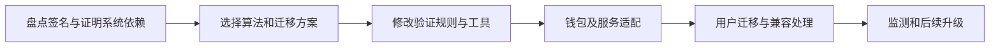

# 后量子密码：区块链要升级什么，才能应对未来量子攻击

[← 学习总目录](README.md) · [近期热点导航](近期Web3热点导航.md)

> **学习目标**：区分签名、密钥协商和哈希的风险，理解后量子算法与链上迁移为什么不是同一件事。
>
> **建议先读**：[公链](公链.md)、[钱包开发分类](钱包开发-分类.md)、[零知识证明](zk.md)。
>
> **资料核验**：2026-11-09 已读取 NIST FIPS 204 官方页面。该标准于 2024-08-13 发布，页面另列有 2026-07-31 的勘误计划说明；本文不预测足够强的量子计算机何时出现。

展开本篇目录

- [1. 为什么会影响区块链](#section-1)
- [2. 三类密码功能不要混淆](#section-2)
- [3. NIST 标准能说明什么](#section-3)
- [4. 为什么链上迁移更复杂](#section-4)
- [5. 公钥暴露为什么需要具体分析](#section-5)
- [6. 性能与组合风险](#section-6)
- [7. 自测与参考答案](#section-7)
- [8. 官方资料与继续搜索](#section-8)

---

## 1. 为什么会影响区块链

区块链依赖数字签名证明账户授权，依赖哈希等结构保护数据关系，也可能使用其他公钥密码和证明系统。量子计算对不同密码问题的影响并不相同。

在具备足够能力的量子计算机条件下，Shor 算法会威胁某些常用公钥密码的数学基础，包括基于椭圆曲线的签名。讨论这种理论威胁，不等于声称今天已经可以任意盗取所有钱包。

威胁评估必须结合算法、参数、可用硬件、攻击时间和具体公钥暴露方式。

## 2. 三类密码功能不要混淆

| 功能 | 用途 | 后量子讨论重点 |
| --- | --- | --- |
| 数字签名 | 授权交易与验证身份 | 签名算法是否抵抗已知量子攻击 |
| 密钥建立 / 封装 | 建立通信加密所需秘密 | 通信是否需要更换密钥建立机制 |
| 哈希 | 数据承诺、索引与完整性关系 | 参数与安全余量，不能直接等同签名风险 |

改用了某种后量子密钥封装算法，并不自动让链上交易签名获得同样保护。给钱包通信升级 TLS，也不等于升级了区块链验证规则。

## 3. NIST 标准能说明什么

FIPS 204 规定 ML-DSA 数字签名算法，其目标包括抵抗拥有大规模量子计算能力的攻击者。官方标准提供算法定义与参数，不负责自动更新任何区块链。

标准公布后，具体实现仍需检查库版本、随机数、侧信道、硬件和错误处理。标准存在勘误与后续维护也很正常，不能把“符合标准”理解成永不需要升级。

“后量子”通常指在经典计算机上运行、面向量子攻击设计的密码算法，不要求用户购买量子设备，也不是量子通信的同义词。

## 4. 为什么链上迁移更复杂

一次迁移会影响地址或账户能力、交易大小、费用、节点验证、硬件钱包、交易所和跨链系统。若只升级客户端，但链仍不接受新签名，用户无法完成相应交易。

还要考虑无人能访问或长期未使用的旧账户、迁移期的攻击窗口，以及协议升级的治理与兼容性。

## 5. 公钥暴露为什么需要具体分析

某些账户或输出结构在花费前不直接公开完整公钥，花费时才暴露；另一些结构则公开公钥或相关可攻击信息。不能把所有地址一概称为同等暴露，也不能说只要地址经过哈希就永远安全。

假设未来攻击者需要一段时间从已知公钥恢复签名能力，长期暴露与短暂广播窗口的风险可能不同。实际分析要结合确认时序、重复使用和协议规则，而不是使用一个统一倒计时。

## 6. 性能与组合风险

后量子签名可能带来不同的公钥、签名大小和验证成本。某些迁移采用混合方案，但“同时使用两种算法”怎样组合才达到预期安全性，也需要规范化设计。

ZK 或 MPC 系统也不是自动免疫：要看使用的曲线、承诺、签名与其他密码假设。营销中的“量子安全链”必须落实到完整技术栈，不能只检查某个单独模块。

## 7. 自测与参考答案

**问题**：一个钱包改用更长的密码，是否就解决了链上签名的量子风险？

**答案**：不是。钱包密码主要保护本地密钥解锁；链上签名安全依赖协议采用的密码算法，两者是不同层。

**练习**：为一款钱包列出本地加密、网络通信、交易签名和链上验证四层，写明每层由谁升级、如何证明兼容。

## 8. 官方资料与继续搜索

- [NIST FIPS 204：ML-DSA](https://csrc.nist.gov/pubs/fips/204/final)：已读取的正式签名标准与维护说明。
- [State of Crypto 2025](https://a16zfrontier.com/posts/article/state-of-crypto-report-2025/)：包含后量子路线的行业讨论；不将其中展望当作攻击能力证明。
- **检索词**：`post-quantum cryptography blockchain`、`ML-DSA`、`FIPS 204`、`quantum resistant wallets`、`后量子签名`。
- **关注度说明**：本篇按公开标准和行业讨论补充，不给出攻击时间预测或实时热搜排名。

---

[← 学习总目录](README.md) · [近期热点导航](近期Web3热点导航.md) · [回到顶部](#top)
