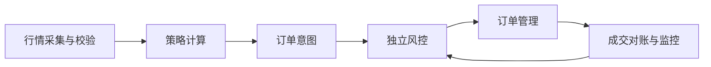

<a id="top"></a>

# 币安量化脚本：从离线信号到可靠订单系统

[← 返回学习导航](README.md)

> **学习目标**：建立数据、信号、风控、订单和对账的完整链路，避免循环重复下单。
>
> **建议先读**：[CEX 现货](CEX-Spot.md)、[TradingView](Tradingview.md)、[风险控制与监控](风险控制与监控.md)。

<details>
<summary>展开本篇目录</summary>

- [1. 先明确本篇范围](#section-1)
- [2. 六个模块各做一件事](#section-2)
- [3. 可运行的离线教学脚本](#section-3)
- [4. 接入公开行情前做什么](#section-4)
- [5. 从信号到订单的关键约束](#section-5)
- [6. 环境、密钥与部署](#section-6)
- [7. 验证路线](#section-7)
- [8. 自测与参考答案](#section-8)
- [9. 延伸阅读](#section-9)

</details>

---


<a id="section-1"></a>

## 1. 先明确本篇范围

量化脚本不仅是“计算指标后调用下单接口”。一个可维护的系统至少需要知道：数据是否完整、信号是否已经处理、当前实际仓位是多少，以及超时订单到底有没有执行。

本篇提供可以离线运行的双均线信号示例，再说明接入交易所的必要步骤。离线示例不需要 API Key，也不会创建真实订单；它不是完整实盘机器人。

<a id="section-2"></a>

## 2. 六个模块各做一件事



| 模块 | 输入与输出 | 失败时怎么办 |
| --- | --- | --- |
| 数据 | 原始行情 → 完整且有时间戳的数据 | 停止产生新信号 |
| 策略 | 已收盘数据 → 目标方向或仓位 | 不用异常默认代替交易信号 |
| 风控 | 订单意图与当前状态 → 允许/拒绝 | 拒绝新增风险并记录原因 |
| 订单管理 | 意图 → 唯一订单与状态 | 超时后先查询 |
| 对账 | 订单、成交、余额 → 实际状态 | 隔离差异并暂停相关策略 |
| 监控 | 指标与事件 → 告警 | 需要有明确响应人或流程 |

策略尽量输出目标状态，由订单层计算差量，避免每次循环都买一遍固定数量。

<a id="section-3"></a>

## 3. 可运行的离线教学脚本

将下面保存为 `signal_demo.py`，使用 Python 3 执行 `python3 signal_demo.py`。不依赖第三方包。

```python
from statistics import mean
from math import isfinite


def crossing_signal(closes, fast=3, slow=5):
    # 输入必须是按时间递增排列的已收盘价格。
    if not 1 <= fast < slow:
        raise ValueError("周期要求 1 <= fast < slow")
    if any(not isfinite(p) or p <= 0 for p in closes):
        raise ValueError("价格必须是有限正数")
    if len(closes) < slow + 1:
        return "HOLD"
    previous = closes[:-1]
    fast_before = mean(previous[-fast:])
    slow_before = mean(previous[-slow:])
    fast_now = mean(closes[-fast:])
    slow_now = mean(closes[-slow:])
    if fast_before <= slow_before and fast_now > slow_now:
        return "BUY"
    if fast_before >= slow_before and fast_now < slow_now:
        return "SELL"
    return "HOLD"


class PaperSignalLog:
    def __init__(self):
        self.seen = set()
        self.events = []

    def process(self, symbol, close_time, closes):
        key = (symbol, close_time)
        if key in self.seen:
            return "DUPLICATE"
        signal = crossing_signal(closes)
        self.seen.add(key)
        self.events.append((key, signal))
        return signal


log = PaperSignalLog()
prices = [5, 4, 3, 2, 3, 8]
assert log.process("DEMO/QUOTE", 100, prices) == "BUY"
assert log.process("DEMO/QUOTE", 100, prices) == "DUPLICATE"
assert len(log.events) == 1
print(log.events)
```

`seen` 只演示内存去重，重启后会丢失；生产系统应把事件和订单状态可靠持久化，并处理多实例竞争。这里记录的是信号，不是成交，不能用它计算真实盈利。

<a id="section-4"></a>

## 4. 接入公开行情前做什么

选择一个明确的市场类型和 API 版本，先只读取公开数据。记录交易对元数据、价格与数量精度、最小金额，以及 K 线时间边界。

过滤未收盘 K 线，检查缺口和重复，并统一使用服务端时间或可靠时钟策略。数据不足时返回等待状态，不要用 0 补成“价格暴跌”。

如果换成 MACD，需要预留指标暖机数据，并按位置读取数据序列。指标参数相同，也可能因初始化和输入区间不同产生差异。

<a id="section-5"></a>

## 5. 从信号到订单的关键约束

执行前读取实际持仓与未成交订单，计算需要新增或减少的数量，再按交易规则对齐。买入预算不能超过可用余额和策略限额；卖出不能假设信号出现就一定持有可卖资产。

为每个业务意图使用可追踪的客户端订单标识，并持久化状态。网络请求超时时，先按标识查询是否已受理；不要把异常捕获后 `return None` 当成“交易没有发生”。

部分成交后按已成交量更新库存，撤单后再核对终态。交易所适配层应隔离现货与合约字段，不能把不同接口的数量、仓位方向和费率混用。

<a id="section-6"></a>

## 6. 环境、密钥与部署

练习先使用标准库完成离线流程。需要 SDK 时只选择适合任务的依赖，固定并记录版本；`python-binance` 与 CCXT 等客户端的接口行为仍应对应官方交易所文档。

测试环境与生产环境必须显式区分。需要认证时，通过运行环境或密钥管理系统注入凭据，不硬编码到脚本、日志或提交文件。权限按实际操作需要配置，交易机器人通常不需要提现权限。

运行进程需要健康检查、受控重试、限流、时钟监控和有界关闭。停止进程前要知道未完成订单仍可能留在交易所，不能把进程退出当成仓位已平。

<a id="section-7"></a>

## 7. 验证路线

先验证离线计算，再做历史回放和样本外评估；随后在可用测试环境或纸面交易模式观察完整生命周期。故障测试应覆盖重复事件、行情过期、下单超时、部分成交、重启恢复和余额不一致。

只有收集成交、手续费和资金变化，才能计算真实策略表现。回测通过、测试接口成功与实盘可靠性属于不同证据。

<a id="section-8"></a>

## 8. 自测与参考答案

**问题**：每分钟计算同一根 1 小时 K 线，为什么可能重复开仓？

**答案**：同一信号会在多个循环中成立；如果没有已收盘 K 线标识、事件去重和目标仓位管理，就可能重复提交订单。

**练习**：给示例增加新的 K 线时间，再模拟脚本重启，解释哪些状态必须从持久化存储恢复。

<a id="section-9"></a>

## 9. 延伸阅读

- [网格交易](网格交易.md)、[三角套利](三角套利.md)、[风险控制与监控](风险控制与监控.md)。
- [Binance Spot API](https://developers.binance.com/docs/binance-spot-api-docs)、[CCXT Manual](https://github.com/ccxt/ccxt/wiki/Manual)。

---

[← 返回学习导航](README.md) · [回到顶部](#top)
