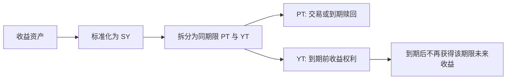

<a id="top"></a>

# 收益代币化与 Pendle：把本金和未来收益拆开交易

[← 学习总目录](README.md) · [近期热点导航](近期Web3热点导航.md)

> **学习目标**：理解 SY、PT、YT 的关系，计算 PT 的隐含收益，并解释为什么 YT 可能随着时间流逝而贬值。
>
> **前置知识**：[DeFi](DeFi.md)、[再质押与 LRT](再质押Restaking与LRT.md)。
>
> **资料核验：2026-11-09**。收益拆分是持续发展的 DeFi 机制；示例价格与收益均为教学假设，不是实时报价。

<details>
<summary>展开本篇目录</summary>

- [1. 为什么要拆分收益](#section-1)
- [2. SY、PT 与 YT 分别是什么](#section-2)
- [3. 从资产到拆分再到到期](#section-3)
- [4. PT 折价怎样转化为隐含收益](#section-4)
- [5. YT 为什么像购买一段未来现金流](#section-5)
- [6. 三类收益不要混在一起](#section-6)
- [7. 自测与参考答案](#section-7)
- [8. 官方资料与检索词](#section-8)

</details>

---


<a id="section-1"></a>

## 1. 为什么要拆分收益

假设一种资产会持续产生收益。持有人既承担本金相关风险，也获得未来收益。如果有人希望锁定较可预测的到期回收，有人希望押注未来收益变高，就可以把两类权利拆开交易。

Pendle 使用标准化收益包装 SY，并围绕指定到期日生成本金代币 PT 和收益代币 YT。它们对应同一收益来源的不同权利，而不是凭空多出两份本金。

最重要的问题不是“现在年化多少”，而是“这一枚代币让我在什么时候，针对哪一种计价资产，取得什么权利”。

<a id="section-2"></a>

## 2. SY、PT 与 YT 分别是什么

| 名称 | 主要角色 | 不能直接假设 |
| --- | --- | --- |
| SY：Standardized Yield | 将不同收益资产包装成统一接口 | 所有 SY 采用相同兑付单位 |
| PT：Principal Token | 对应到期本金相关赎回权利 | 任何 PT 都兑付 1 美元 |
| YT：Yield Token | 对应到期前约定的收益权利 | 购买后本金始终可回收 |

PT 和 YT 的具体权益取决于底层资产及市场定义。LST、稳定币收益资产和 RWA 收益凭证的计价方式与风险并不相同。

有些市场涉及奖励或积分，需要核查具体规则。项目积分不是确定可变现的现金流，也不能在教学收益公式中直接当作美元利润。

<a id="section-3"></a>

## 3. 从资产到拆分再到到期



提前退出时，PT 和 YT 都可能受市场价格与流动性影响。PT 的“到期收益较可预测”是建立在持有到期、底层履约和计价资产不出问题等条件上的，不能推广为随时卖出都保本。

YT 到期后不再代表新的未来收益；但是否还有已产生而未领取的收益，需要看协议的领取与结算规则，不能把这部分直接当作凭空消失。

<a id="section-4"></a>

## 4. PT 折价怎样转化为隐含收益

假设某市场的 100 份 PT，在到期时对应 100 单位明确的计价资产；现在购买花费 97 单位，同样以该资产计价，距离到期 90 天。

```text
持有期收益率 = (100 - 97) / 97 ≈ 3.09%
简单年化     = 3 / 97 × 365 / 90 ≈ 12.54%
```

这里的 12.54% 是简单年化展示，不是 90 天能赚 12.54%，也不是承诺未来一年可以按同样条件重复买入。采用复利年化会得到不同数字，应先确认界面的口径。

如果购买和到期赎回合计成本为 0.5 单位，则按初始投入 97.5 计算，净持有期收益为 `2.5 / 97.5 ≈ 2.56%`。费用会明显影响短期限产品。

若计价资产本身相对美元下跌，资产单位上的正收益仍可能对应美元亏损。

<a id="section-5"></a>

## 5. YT 为什么像购买一段未来现金流

假设买入一组 YT 花费 4 单位资产，期限内实际领取可计价收益 3，忽略费用与残余可领收益，则净损益为 -1。底层收益为正，不代表买入 YT 的人盈利，因为还要收回购买成本。

反过来，若实际收益达到 6，净损益为 2。YT 对未来收益预期敏感；剩余期限越短，可产生收益的时间越少。

因此，分析 YT 至少需要同时考虑：买入价格、剩余时间、未来利率路径、奖励权益、费用与底层风险。只看一个历史 APY 很容易误判。

<a id="section-6"></a>

## 6. 三类收益不要混在一起

| 收益来源 | 如何理解 | 主要变化因素 |
| --- | --- | --- |
| PT 持有至到期 | 折价购买与约定到期兑付的差额 | 买价、期限、兑付单位与履约 |
| YT 持有 | 买入未来收益权利后获得实际现金流 | 实际收益、买入成本、奖励规则 |
| 提供流动性 | 为市场交易提供资金并承担 LP 敞口 | 交易量、费用、价格变化、激励 |

PT 被用作借贷抵押品后，还会引入清算风险。即便最终可按规则兑付，中途的折价或抵押率调整也可能导致被动卖出。

底层协议风险、SY 包装风险与市场流动性风险也会叠加。拆分收益改变的是权利组织方式，并不会消除原有风险。

<a id="section-7"></a>

## 7. 自测与参考答案

**题目一**：某 PT 从 95 涨到 97，距离到期不变、到期兑付单位不变，新买家的隐含收益如何变化？

**答案**：下降。支付更多成本获得相同的到期回收额，折价收益减少。

**题目二**：YT 买价为 5，实际领取收益 7，费用 0.4，净利润多少？

**答案**：`7 - 5 - 0.4 = 1.6`，且必须确保三者使用相同计价单位。

**实践练习**：选择一个市场，只记录资产名称、到期日、PT 赎回单位、YT 权益和退出深度。先完成这五项，再看界面年化，避免被一个百分数替代完整产品理解。

<a id="section-8"></a>

## 8. 官方资料与检索词

- [Pendle 官方介绍](https://docs.pendle.finance/pendle-v2/Introduction)：收益代币化、SY、PT 与 YT 的关系。
- [Pendle 文档入口](https://docs.pendle.finance/)：查阅具体市场机制、费用和赎回说明。

**检索词**：Pendle PT YT、收益代币化、implied APY、principal token、yield token、SY 到期赎回。

**继续阅读**：[再质押与 LRT](再质押Restaking与LRT.md)解释部分收益来源；[风险控制与监控](风险控制与监控.md)帮助拆分持有收益与杠杆风险。

---

[← 学习总目录](README.md) · [近期热点导航](近期Web3热点导航.md) · [回到顶部](#top)
