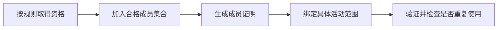

# 真人证明与数字身份：证明“是人”，是否必须透露“是谁”

[← 学习总目录](README.md) · [近期热点导航](近期Web3热点导航.md)

> **学习目标**：区分身份、账户控制、真人性、唯一性与实名，理解匿名证明如何限制重复参与。
>
> **建议先读**：[零知识证明](zk.md)、[SocialFi](SocialFi.md)、[ERC-8004 与 KYA](ERC-8004与智能体身份.md)。
>
> **资料核验**：2026-11-09 已读取 World ID 与 Semaphore 官方仓库。World ID 的仓库提供 4.0 规范入口；本文讲通用机制，不混用不同版本的 SDK 字段，也不把项目声明当作绝对安全保证。

展开本篇目录

- [1. AI 内容增加后，为什么更需要区分参与者](#section-1)
- [2. 五个经常混在一起的问题](#section-2)
- [3. 匿名成员证明如何工作](#section-3)
- [4. 一人一票的例子](#section-4)
- [5. World ID 在其中是什么角色](#section-5)
- [6. 抗女巫不等于没有作恶](#section-6)
- [7. 自测与参考答案](#section-7)
- [8. 官方资料与继续搜索](#section-8)

---

## 1. AI 内容增加后，为什么更需要区分参与者

点赞、投票、领券和社区治理常假设“一个账户代表一个独立参与者”。现实中，一个操作者可以创建大量账户，智能体还能自动生成行为与内容。

Proof of Personhood（PoP，真人或人格证明）围绕人类参与和抗多身份滥用展开，但不同方案验证的目标不同：是真人、在场的人、符合某条件的人，还是系统中尚未注册过的人。

“能证明是人”不表示该人值得信任，也不表示其每一条内容都由本人编写。

## 2. 五个经常混在一起的问题

| 问题 | 典型证明对象 | 不能替代什么 |
| --- | --- | --- |
| 账户控制 | 持有签名密钥或登录凭据 | 真人性 |
| 真人性 | 符合方案要求的人类验证 | 法律姓名与资格 |
| 唯一性 | 在指定系统中未重复注册 | 跨所有系统唯一 |
| 实名 / KYC | 身份资料与主体关系 | 每次操作都由本人主动执行 |
| 属性证明 | 年龄、成员资格等条件 | 对全部身份信息的核验 |

一个 Agent 可以合法代表真实用户工作。系统需要判断该场景是否允许代理，而不是简单把所有非人工点击都归为攻击。

## 3. 匿名成员证明如何工作

Semaphore 提供匿名群组成员证明等机制：用户可以证明属于某个群组，而不公开自己是其中哪一个。**群组如何筛选成员**是另一层问题；把一个地址加入群组，不会自动使它成为独一无二的人。

用于限制重复参与的标记常称 nullifier，具体计算与范围绑定由协议定义。它帮助业务识别重复动作，而不必公开用户完整身份。

## 4. 一人一票的例子

某活动有 1,000 名符合资格的成员，规则要求每人在这次活动最多投一票。应用验证群组成员证明，并保存该活动范围内已使用的 nullifier。

若只验证成员身份而不检查重复使用，同一个成员可能多次投票。若把跨活动标记设计得可直接关联，则可能牺牲用户在不同场景中的隐私。

后端并发也要处理：同一个证明同时提交两次时，重复检查与记录应具有一致性，不能分别检查后都放行。

## 5. World ID 在其中是什么角色

World ID 官方仓库将其描述为匿名真人证明协议，并提供智能合约、库与服务等组件。实际能力取决于凭证类型、验证流程和协议版本，不能把所有凭证都当成相同强度的真人与唯一性保证。

接入前要看资格如何获得、恢复如何进行、密钥丢失或身份变更怎样处理，以及服务、设备和运营方分别承担什么职责。

产品宣传中的“隐私保护”还需转化为具体问题：谁见过原始资料、保留什么、是否可关联、哪些数据会传给业务方。

## 6. 抗女巫不等于没有作恶

一个真实用户仍可以售卖账户访问、接受报酬投票或提交错误内容。因此真人证明只是降低某类滥用成本的工具，不能替代信誉、内容审核、资金风控或利益冲突管理。

对于重要权益，要评估误拒绝与覆盖问题：没有特定设备、证件或地区服务的人，是否还有合理替代路径？抗滥用与可访问性需要同时设计。

## 7. 自测与参考答案

**问题**：匿名证明通过后，网站可以说“我们已验证你的真实姓名和年龄”吗？

**答案**：只有实际证明了这些属性才能这样说。证明成员资格或真人性，不自动包含姓名与年龄。

**练习**：为一次社区投票分别定义资格、匿名性、重复限制、恢复与代理规则，指出哪些由密码学负责，哪些依赖运营流程。

## 8. 官方资料与继续搜索

- [World ID 官方仓库](https://github.com/worldcoin/world-id-protocol)：协议组件与版本入口。
- [World ID 文档](https://docs.world.org/world-id/overview)：产品和集成入口，具体凭证须查对应章节。
- [Semaphore 官方仓库](https://github.com/semaphore-protocol/semaphore)：匿名群组成员证明。
- **检索词**：`proof of personhood`、`proof of human`、`World ID`、`Semaphore nullifier`、`Sybil resistance`。
- **关注度说明**：AI 与身份信任是公开报告讨论方向；这里不提供未经核验的关键词搜索量。

---

[← 学习总目录](README.md) · [近期热点导航](近期Web3热点导航.md) · [回到顶部](#top)
