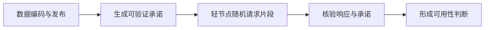

# 模块化区块链与 DA：为什么正确的状态根还不够

[← 学习总目录](README.md) · [近期热点导航](近期Web3热点导航.md)

> **学习目标**：区分执行、结算、数据可用性和长期存储，理解 DAS 的作用与边界。
>
> **建议先读**：[Layer1](Layer1.md)、[Layer2](Layer2.md)、[零知识证明](zk.md)。
>
> **选题定位**：理解 Rollup、专用链与扩容讨论所需的基础设施延伸课。2026-11-09 已读取 Celestia 官方节点仓库的 DA/DAS 说明；不提供实时项目排名。

展开本篇目录

- [1. 单体与模块化是分工差异](#section-1)
- [2. 四种职责需要分别问](#section-2)
- [3. 有状态根，为什么还需要数据](#section-3)
- [4. DAS 用抽样降低检查负担](#section-4)
- [5. Celestia 在其中做什么](#section-5)
- [6. Rollup、Validium 与外部 DA](#section-6)
- [7. 自测与参考答案](#section-7)
- [8. 官方资料与继续搜索](#section-8)

---

## 1. 单体与模块化是分工差异

单体区块链通常把执行、排序共识、结算和数据传播等职责集中处理。模块化设计把部分职责拆开，由不同系统协作。

这样可以专门优化某个环节，但同时增加接口、证明和信任依赖。模块越多并不自动越先进，要看整体系统是否更满足业务需求。

## 2. 四种职责需要分别问

| 职责 | 关键问题 | 典型结果 |
| --- | --- | --- |
| 执行 | 交易怎样改变状态？ | 新余额与合约存储 |
| 排序与共识 | 大家接受怎样的历史顺序？ | 区块或交易顺序 |
| 结算 | 哪个状态承诺被最终认可？ | 被验证或裁定的结果 |
| 数据可用性 DA | 验证或重建所需的数据是否可获得？ | 对所需数据可获取的保障 |

长期归档则关注更远时间后是否还保留完整资料。DA 不是“免费永久网盘”，也不是数据内容合法、真实或有价值的证明。

## 3. 有状态根，为什么还需要数据

状态根可以像账本摘要，帮助检查某份数据与承诺是否匹配。但只有摘要，没有账本明细，用户未必能重建状态或构造所需证明。

比如运营者说“你的余额现在是 100”，并公布一个状态根。没有相关状态和证明材料时，用户可能无法独立验证自己的余额，也可能无法完成退出。

有效性证明可以约束计算正确，但数据被扣留仍可能损害可用性和退出。正确性与可用性不能相互替代。

## 4. DAS 用抽样降低检查负担

Data Availability Sampling（数据可用性抽样）利用数据编码与随机抽样，让轻节点不必下载全部区块数据，也能在规定假设下获得可用性信心。

教学直觉：若固定有 10% 数据片段不可获取、每次独立均匀抽样，20 次全部没碰到缺失片段的概率为 `0.9^20 ≈ 12.16%`。

这只是解释抽样思想，不是任何 DA 网络的真实安全参数。实际方案还涉及纠删码、重建阈值、攻击者策略、网络隔离和采样独立性。

## 5. Celestia 在其中做什么

Celestia 官方节点仓库描述了 DA 网络与数据抽样节点。可以将它作为研究“专门承担数据可用性职责”的例子，而不是当作所有应用都在其上直接执行的通用合约环境。

一个应用使用外部 DA，还需要明确在哪执行、在哪结算，以及结算层怎样接受 DA 相关信息。不能只把模块名称画在图中，就省略中间验证机制。

## 6. Rollup、Validium 与外部 DA

如果一个系统把必要数据放在结算 L1 之外，它的数据可用性假设就可能不同。即使执行代码相同，也不一定获得与把数据发布在 L1 的 Rollup 相同的保障。

评估时问：数据发布失败怎么办、轻节点怎样判断可用、谁能重建状态、运营者停机后用户能否退出、长期历史由谁归档。

成本比较也应包含发布、证明、结算、归档和运维，而不只看每字节报价。

## 7. 自测与参考答案

**问题**：一批交易的证明通过，是否能推断任何用户都能立即获取该批交易的全部数据？

**答案**：不能。计算有效性与数据可获取性是不同性质，需查看数据发布与验证机制。

**练习**：画一条使用外部 DA 的应用链，把执行、共识、结算、数据发布和用户退出分别标出；未知接口用问号保留。

## 8. 官方资料与继续搜索

- [Celestia Node 官方仓库](https://github.com/celestiaorg/celestia-node)：DA 网络、节点角色和 DAS 入口。
- [Ethereum 扩容资料](https://ethereum.org/en/developers/docs/scaling/)：延伸阅读，配合现有 L2 教程理解不同方案。
- **检索词**：`modular blockchain`、`data availability DA`、`DAS`、`Celestia`、`validium vs rollup`。

---

[← 学习总目录](README.md) · [近期热点导航](近期Web3热点导航.md) · [回到顶部](#top)
