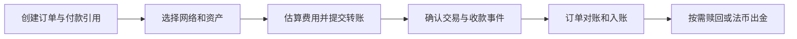

<a id="top"></a>

# 稳定币专用链：Tempo、Arc 与支付基础设施

[← 学习总目录](README.md) · [近期热点导航](近期Web3热点导航.md)

> **学习目标**：理解为什么支付应用需要专门优化的链，区分稳定币转账、Gas 计费和法币结算，并能评估一条支付链的接入成本。
>
> **前置知识**：[公链](公链.md)、[稳定币支付与 PayFi](稳定币支付与PayFi.md)。
>
> **资料核验：2026-11-09**。本篇属于支付基础设施延伸；项目文档用于核对机制，不代表实时搜索排名。

<details>
<summary>展开本篇目录</summary>

- [1. 一句话理解：把支付的常见麻烦放进基础设施](#section-1)
- [2. 三件事必须分开看](#section-2)
- [3. Tempo 与 Arc：如何读官方资料](#section-3)
- [4. 一笔商户收款怎样完成](#section-4)
- [5. 教学案例：为什么余额够也可能付不了](#section-5)
- [6. 选链时真正需要比较什么](#section-6)
- [7. 自测与参考答案](#section-7)
- [8. 官方资料与检索词](#section-8)

</details>

---


<a id="section-1"></a>

## 1. 一句话理解：把支付的常见麻烦放进基础设施

稳定币专用链，是围绕稳定币发行、转账、交易和业务接入优化的区块链。它并不创造一种“天然不会脱锚的币”，也不自动把链上余额变成银行账户里的钱。

普通链上，用户可能持有 100 USDC，却因为没有原生 Gas 币而无法转账。企业还会遇到批量付款、交易备注、对账、权限控制和费用预测问题。支付导向的链尝试减少这些摩擦，让开发者把精力放在业务上。

可以把它理解为面向支付业务设计的道路：道路改善通行，但车辆里的资产是否足额、目的地银行是否接受兑换，仍取决于其他参与方。

<a id="section-2"></a>

## 2. 三件事必须分开看

| 层次 | 解决的问题 | 不能自动解决的问题 |
| --- | --- | --- |
| 稳定币发行方 | 谁发行、储备与赎回规则是什么 | 链的排序与交易执行 |
| 区块链 | 转账如何执行、计费、确认 | 银行营业时间与法币出金资格 |
| 支付服务商 | 商户收款、换汇、对账与退款 | 所有链上交易都可撤销 |

“以稳定币支付 Gas”只改变付费资产及相关计费机制，不意味着没有手续费。费用可以由用户承担，也可以由应用赞助；赞助只是换了付款人。

“稳定费用”也要看口径：可能指按美元更容易估算，不能据此推断任何拥堵情况下费用都固定。

<a id="section-3"></a>

## 3. Tempo 与 Arc：如何读官方资料

| 观察点 | Tempo | Arc |
| --- | --- | --- |
| 官方入口 | 当前开发者入口迁移至 tempo.xyz/developers | 当前文档入口为 docs.arc.io |
| 阅读重点 | 稳定币产品、TIP-20、账户与付款工具 | 稳定币原生模型、USDC Gas、EVM 差异 |
| 环境识别 | 快速入门出现 Moderato 测试网与测试资产 | 核验时首页声明主网已上线 |
| 接入前核对 | 目标网络、资产地址、精度、费用资产 | 网络配置、USDC 表示方式、Gas 与运行时差异 |

Tempo 的开发者目录同时包含 Accounts、Earn、Routes、Zones 和 Machine Payments。它们是不同产品或能力入口，不能把其中一个快速入门流程当成整个生态的统一部署状态。

Arc 文档明确采用 USDC 支付 Gas，并说明原生表示使用 18 位精度。开发者不能因为熟悉其他链上的 6 位精度 USDC，就直接复用余额解析代码；应针对读取的原生或合约接口核验单位。EVM 兼容也不表示所有运行时行为与 Ethereum 完全一致。

<a id="section-4"></a>

## 4. 一笔商户收款怎样完成



第一步把订单金额、网络、资产地址和收款方绑定在一起。随后钱包提交付款，服务端检查链 ID、资产、收款方、实际金额以及交易状态，再把支付事件映射到订单。

同一交易的通知可能重复到达，因此应以明确的交易和事件标识防止重复入账。区块链确认之后，出金服务仍可能处于审核、处理中或银行到账阶段，界面需要分别展示。

付款引用适合放订单标识或哈希；不要把客户姓名、电话等直接写进公开链上备注。

<a id="section-5"></a>

## 5. 教学案例：为什么余额够也可能付不了

假设用户有 100 单位支付稳定币，订单也是 100，预估网络费为 0.02。为便于计算，假设订单和费用使用同一种资产，且费用由用户承担。

```text
需要余额 = 订单金额 + 网络费 = 100 + 0.02 = 100.02
现有余额 = 100
缺口     = 0.02
```

此时不能提交完整订单。应用可以提示补足余额，或在产品支持的前提下赞助费用，但不能悄悄把商户实收改成 99.98。

如果应用每天赞助 10,000 笔同样费用的交易，教学假设下日成本为 200 单位稳定币。真实预算还要计入失败交易、费率变化和服务商费用；“用户无 Gas 感知”并不意味着运营零成本。

<a id="section-6"></a>

## 6. 选链时真正需要比较什么

除了交易速度，至少需要确认四类条件：资产是否原生发行及可赎回、业务是否需要跨链、确认后的失败恢复方式、基础设施能否支持对账。

| 问题 | 为什么影响业务 |
| --- | --- |
| 收到的是哪一种稳定币？ | 同名资产、包装资产与发行方支持资产可能不同 |
| 谁能冻结、升级或暂停？ | 资产和链可能存在不同权限主体 |
| 退款如何实现？ | 一般是新增一笔返款交易，需要费用和权限 |
| 最终性怎样定义？ | API 返回成功不等于商户可立即按最终到账处理 |
| 出金依赖谁？ | 链上全天运行不能保证银行通道全天可用 |

新链还有工具成熟度、流动性和跨链成本。若用户主要资产在另一条链，应把桥接及兑换步骤纳入完整体验，而不是只比较单笔链内转账费用。

<a id="section-7"></a>

## 7. 自测与参考答案

**题目一**：一条链允许用 USDC 付 Gas，是否代表转账免费？

**答案**：不代表。它说明费用可以用 USDC 支付；费用金额、承担者及失败时是否收费仍要看协议和业务安排。

**题目二**：支付交易已最终确认，是否可以立即显示“银行到账”？

**答案**：不可以。链上结算与法币出金是不同阶段，需要出金服务的实际状态。

**实践练习**：为 25 单位稳定币订单设计状态：待支付、链上处理中、链上已确认、出金处理中、银行已到账；再补上支付不足和出金失败的恢复动作。目标是让每个状态都有证据来源。

<a id="section-8"></a>

## 8. 官方资料与检索词

- [Tempo 开发者入口](https://tempo.xyz/developers)：产品目录与网络接入入口。
- [Tempo 稳定币指南](https://tempo.xyz/developers/get-started/stablecoins.md)：核对资产、单位与支付相关概念。
- [Arc 官方文档](https://docs.arc.io/)与[稳定币原生模型](https://docs.arc.io/arc/concepts/stablecoin-native-model.md)。
- [Arc EVM 差异](https://docs.arc.io/arc/references/evm-differences)：接入时优先核对的运行时边界。

**检索词**：稳定币专用链、Tempo TIP-20、Arc USDC gas、stablecoin-native chain、支付链对账。

**继续阅读**：[稳定币支付与 PayFi](稳定币支付与PayFi.md)关注业务资金流；[跨链桥](跨链桥.md)解释跨网络转移所增加的信任依赖。

---

[← 学习总目录](README.md) · [近期热点导航](近期Web3热点导航.md) · [回到顶部](#top)
