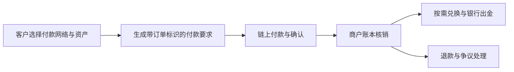

<a id="top"></a>

# 稳定币支付与 PayFi：从链上转账走向真实收付款

[← 学习总目录](README.md) · [近期热点导航](近期Web3热点导航.md)

> **学习目标**：区分稳定币、支付基础设施与支付融资，算清到账时间、汇兑和资金占用。
>
> **建议先读**：[DeFi](DeFi.md)、[RWA](RWA.md)、[跨链桥](跨链桥.md)。
>
> **选题依据**：2025 行业报告及面向 2026 的趋势展望把稳定币和支付列为重点；PayFi 是生态叙事与业务分类，不是统一协议标准。资料核验日期：2026-11-09。

<details>
<summary>展开本篇目录</summary>

- [1. 稳定币为什么适合被讨论为支付工具](#section-1)
- [2. 三层业务怎样区分](#section-2)
- [3. 商户收款的完整流程](#section-3)
- [4. 跨境付款的成本例子](#section-4)
- [5. PayFi 如何利用资金时间价值](#section-5)
- [6. 跨链稳定币与普通转账](#section-6)
- [7. 自测与参考答案](#section-7)
- [8. 官方资料与继续搜索](#section-8)

</details>

---


<a id="section-1"></a>

## 1. 稳定币为什么适合被讨论为支付工具

稳定币通常以维持某个计价单位的价格为目标，让用户能够以相对熟悉的单位转移价值。可编程转账、较长的服务时间覆盖和跨地区接入，使其适合探索跨境结算、企业付款和机器支付。

但“目标稳定”不等于永远可按面值赎回。发行方、储备、赎回资格、冻结权限、银行通道和市场流动性都会影响可用性。

稳定币账面转账、商户确认收款、兑换当地法币和最终银行到账，也不是同一时点。

<a id="section-2"></a>

## 2. 三层业务怎样区分

| 层次 | 核心问题 | 例子 |
| --- | --- | --- |
| 稳定币资产 | 谁发行，什么权利支撑它？ | 法币储备支持或加密抵押机制 |
| 支付基础设施 | 谁接单、转账、对账和处理退款？ | 收款 API、钱包、链、出入金服务 |
| PayFi / 支付融资 | 结算时间差怎样产生资金需求？ | 商户提前收款、跨境营运资金 |

不是所有稳定币都有相同储备结构，也不是所有稳定币支付都涉及融资。把一笔普通转账称作 PayFi，不能自动证明存在新的商业价值。

<a id="section-3"></a>

## 3. 商户收款的完整流程



订单应绑定链、代币合约、金额、收款人和有效期。商户不能只凭客户端传回的交易哈希交货，应验证真实资金流和所需确认状态。

退款常常需要另发一笔支付，并核对网络、地址和费用。链上交易不能像删除数据库记录那样撤回。

<a id="section-4"></a>

## 4. 跨境付款的成本例子

假设企业发送 10,000 USDC：网络及服务费用共 3 USDC，收款方换成本地货币时再承担相当于 0.2% 的汇兑成本。

```text
费用近似值 = 3 + 10,000 × 0.2% = 23 USDC
综合成本率 ≈ 0.23%
```

这个例子不含银行收费、税费和脱锚损失。对比传统付款渠道时，还要比较到账时间、汇率锁定方式、失败退款和收款人的实际可用资金。

“Gas 只花几分钱”不足以说明整条支付链路成本低。

<a id="section-5"></a>

## 5. PayFi 如何利用资金时间价值

商户应收款 10,000，正常 30 天后到账。融资方今天支付 9,950，30 天后收取 10,000，差额 50 是融资毛收入。

```text
简单年化毛收益近似值 = 50 / 9,950 × 365 / 30 ≈ 6.11%
```

这不是无风险利息。需要扣除资金成本、违约损失、手续费及闲置时间，还要确认应收款真实存在、未被重复融资，并有可执行的追索或担保安排。

如果收益主要来自发放奖励代币，就应把奖励补贴与商户真实融资利息分开。

<a id="section-6"></a>

## 6. 跨链稳定币与普通转账

Circle CCTP 的官方资料描述以销毁和铸造等机制实现原生资产跨链转移。它与第三方锁仓后发行包装币的模型不同；跨链仍涉及消息确认、服务可用性和失败恢复。

具体网络、资产和接口支持随版本更新，不能凭“支持 USDC”就推定所有链和所有同名代币都可互换。原生 USDC 与某桥发行的同名凭证应分别核对。

<a id="section-7"></a>

## 7. 自测与参考答案

**问题**：商户链上收到稳定币，为什么当天仍可能无法支付当地工资？

**答案**：还可能需要兑换、满足出金条件并经过银行通道。链上可用与法币账户可用是两个阶段。

**练习**：画出一笔国际货款的资产流，标出谁承担汇率变化、脱锚、融资违约和提现暂停风险。

<a id="section-8"></a>

## 8. 官方资料与继续搜索

- [Circle CCTP 文档](https://developers.circle.com/cctp)：实际跨链机制，具体支持范围按当前文档核对。
- [State of Crypto 2025](https://a16zfrontier.com/posts/article/state-of-crypto-report-2025/)：支付与采用背景，报告数据不代表当前实时值。
- [2026 趋势展望](https://a16zfrontier.com/posts/article/big-ideas-things-excited-about-crypto-2026/)：稳定币支付的展望，不作为已实现结果。
- **检索词**：`stablecoin payments`、`PayFi`、`payment financing`、`cross-border stablecoin settlement`、`CCTP`。

---

[← 学习总目录](README.md) · [近期热点导航](近期Web3热点导航.md) · [回到顶部](#top)
