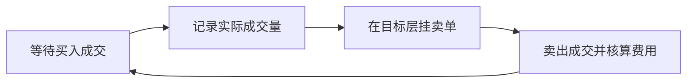

<a id="top"></a>

# 网格交易：把区间波动转换成一组有状态的订单

[← 返回学习导航](README.md)

> **学习目标**：计算网格价位与单格净收益，理解已实现收益和库存浮亏的差别。
>
> **建议先读**：[CEX 现货](CEX-Spot.md)、[风险控制与监控](风险控制与监控.md)。

<details>
<summary>展开本篇目录</summary>

- [1. 网格在做什么](#section-1)
- [2. 等距与等比网格](#section-2)
- [3. 可运行的价位生成器](#section-3)
- [4. 一格赚多少](#section-4)
- [5. 网格必须是状态机](#section-5)
- [6. 区间外怎么处理](#section-6)
- [7. 自测与参考答案](#section-7)
- [8. 延伸阅读](#section-8)

</details>

---


<a id="section-1"></a>

## 1. 网格在做什么

网格策略把价格区间划分为若干层，在指定价位买入，按规则在更高价位卖出。它依赖价格来回波动，持有过程中会不断改变基础资产与现金库存。

它不需要每次预测精确转折，但仍隐含对交易区间、波动与长期方向的假设。单边下跌时可能持续买入并积累浮亏，单边上涨时可能逐渐卖空库存而落后于持币。

<a id="section-2"></a>

## 2. 等距与等比网格

| 类型 | 公式 | 含义 |
| --- | --- | --- |
| 等距 | `P_i = L + i(U-L)/N` | 每格绝对价差相等 |
| 等比 | `P_i = L × (U/L)^(i/N)` | 每格价格比例相等 |

L 是下限，U 是上限，N 是区间数，因此价位有 N+1 个。等比网格并不因此自动适合所有趋势行情，它只是改变间距分布。

假设 L=80、U=120、N=4，等距价位为 80、90、100、110、120。价格在 100 附近时，系统需要决定哪些层挂买单、哪些层用已有库存挂卖单，不能在每个层无条件同时挂两边。

<a id="section-3"></a>

## 3. 可运行的价位生成器

以下 Python 3 示例只生成参数，不连接交易所。

```python
from decimal import Decimal


def grid_levels(lower, upper, intervals):
    lower, upper = Decimal(str(lower)), Decimal(str(upper))
    if not 0 < lower < upper or not isinstance(intervals, int) or intervals <= 0:
        raise ValueError("需要正数区间和正整数格数")
    step = (upper - lower) / intervals
    return [lower + i * step for i in range(intervals + 1)]

assert grid_levels(80, 120, 4) == list(map(Decimal, [80, 90, 100, 110, 120]))
print(grid_levels(80, 120, 4))
```

真实订单价位还必须按 tick size 对齐；如果相邻价位取整后相同，应减少格数或调整区间。数量也要满足最小数量和最小名义金额规则。

<a id="section-4"></a>

## 4. 一格赚多少

假设在 100 买 1 单位，在 102 卖出，两边手续费均为 0.1%，按计价资产扣费：

```text
净收益 = 102 × (1 - 0.001) - 100 × (1 + 0.001)
       = 1.798
```

这是已完成一买一卖的配对收益。它没有覆盖仍持有资产的浮亏、其他失败交易和资金占用。网格越密，单格价差越可能被手续费和滑点吞掉。

<a id="section-5"></a>

## 5. 网格必须是状态机



不能每次循环发现“价格低于某层”就再次下单。每一格应记录订单 ID、方向、实际成交量和后续动作；部分成交时只能处理已成交的部分。

重启后先读取真实未成交单与库存，再恢复格子状态。否则容易重复挂单、卖出不存在的资产或忽略已在交易所执行的订单。

<a id="section-6"></a>

## 6. 区间外怎么处理

价格跌破下限后，可以按事先规则暂停新增、保留库存或减仓；价格突破上限后，可以暂停、重新评估或继续持有剩余资产。每种选择都改变风险，不能靠自动扩大区间掩盖亏损。

调整网格时需要先处理旧订单，避免新旧策略同时占用资金。合约网格还叠加资金费、杠杆和清算，本篇普通现货模型不能直接套用。

<a id="section-7"></a>

## 7. 自测与参考答案

**问题**：界面显示网格利润 +100，账户总权益却少了 200，可能吗？

**答案**：可能。已配对订单盈利 100，但未卖库存浮亏 300，整体仍亏 200，另可能存在费用等差异。

**练习**：模拟价格 `100 → 90 → 100 → 80`，列出每次成交后现金、库存和按市价估值的总权益，而不只统计平仓收益。

<a id="section-8"></a>

## 8. 延伸阅读

- [滑点](滑点.md)、[币安量化脚本](币安量化脚本.md)、[统计套利](统计套利.md)。

---

[← 返回学习导航](README.md) · [回到顶部](#top)
