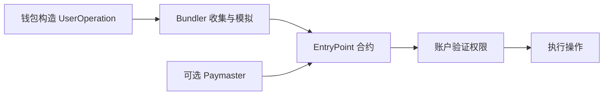

# 账户抽象与 EIP-7702：让账户拥有可编程的操作规则

[← 学习总目录](README.md) · [近期热点导航](近期Web3热点导航.md)

> **学习目标**：分清 ERC-4337、EIP-7702、Paymaster 和 Session Key，理解“少弹窗”的权限代价。
>
> **建议先读**：[钱包开发分类](钱包开发-分类.md)、[连接钱包](Connectwallet.md)。
>
> **版本核验**：2026-11-09 官方页面显示 ERC-4337 与 EIP-7702 均为 **Final**。账户抽象不是近期才诞生；新意在于账户能力与用户体验的持续组合。

展开本篇目录

- [1. 账户抽象解决什么痛点](#section-1)
- [2. ERC-4337 的执行路径](#section-2)
- [3. EIP-7702 改变什么](#section-3)
- [4. 容易混淆的五个概念](#section-4)
- [5. 一键兑换的教学案例](#section-5)
- [6. 怎样检查权限边界](#section-6)
- [7. 自测与参考答案](#section-7)
- [8. 官方资料与继续搜索](#section-8)

---

## 1. 账户抽象解决什么痛点

传统 EOA 操作通常围绕一把密钥展开，用户需要管理原生 Gas 资产、逐笔确认，并自己保管恢复材料。账户抽象把部分验证和执行逻辑做成可编程规则，使批处理、费用代付、恢复和限权会话成为可能。

它不是“取消签名”。系统仍要明确谁能发起操作、验证什么、谁付手续费，以及用户失去设备后如何恢复控制。

## 2. ERC-4337 的执行路径

UserOperation 表达用户希望执行的操作；Bundler 将其按规则送上链；EntryPoint 协调验证与执行；账户定义具体授权逻辑。Paymaster 是可选的费用支持机制。

上述角色并不必然由同一家公司提供。可用性、拒绝策略、版本兼容和被赞助额度，都会影响用户能否完成操作。

## 3. EIP-7702 改变什么

EIP-7702 允许 EOA 通过特定授权机制设置指向代码地址的委托标记，让该账户能够执行相应委托逻辑。

**委托不是只在一笔业务交易结束时自动消失。** 选中的实现可能影响后续账户行为，用户应能识别委托目标、理解授权范围，并在支持的流程下更新或清除委托。

7702 也不会自动赋予任何钱包社交恢复、批处理或安全会话。这些能力由委托实现及配套钱包基础设施提供。ERC-4337 与 7702 可协作，不是二选一的产品名称。

## 4. 容易混淆的五个概念

| 概念 | 主要作用 | 不代表什么 |
| --- | --- | --- |
| 账户抽象 | 可编程授权与执行体验 | 免费且无限交易 |
| ERC-4337 | 以 UserOperation 等机制支持账户操作 | 修改所有链的共识 |
| EIP-7702 | 给 EOA 设置代码委托能力 | 所有签名都临时且可无条件撤销 |
| Paymaster | 按规则支持支付费用 | 没有人承担成本 |
| Session Key | 允许特定会话执行受限操作 | 等同于用户完整私钥 |

Session Key 是设计模式，具体权限不是靠名字保证。可调用合约、方法、额度、时间和撤销条件必须由实际验证逻辑约束。

## 5. 一键兑换的教学案例

用户想完成“授权代币 + 兑换”。账户可将多个调用组合，减少用户交互。但是否全部成功或全部失败，取决于账户批处理实现是否允许单项失败，不能看到“批量”就假定原子性。

平台代付 Gas 时，可以限制“每天最多两次、每次费用不超过指定值、只允许指定合约”。若赞助额度耗尽，应明确提示由谁继续付款，而不是出现没有解释的失败。

## 6. 怎样检查权限边界

以游戏会话为例，可允许一天内调用指定游戏合约最多 100 次，但禁止代币转账、修改恢复者和升级模块。用户退出游戏后，要能撤销该会话，而不影响正常钱包使用。

检查委托实现的升级权限、初始化、重放保护、nonce、链绑定和存储兼容。一次看似“升级钱包体验”的签名，可能赋予比普通登录签名更广的能力。

## 7. 自测与参考答案

**问题**：Paymaster 代付 Gas 后，交易失败是否就没有任何成本？

**答案**：不是。成本由赞助者或其他机制承担；还要看赞助协议怎样结算失败操作，并防止资源滥用。

**练习**：为电商付款会话写出允许收款人、单次上限、累计上限、有效期和撤销方式，明确哪些检查必须在授权执行路径中强制生效。

## 8. 官方资料与继续搜索

- [ERC-4337](https://eips.ethereum.org/EIPS/eip-4337)：UserOperation、EntryPoint、Paymaster。
- [EIP-7702](https://eips.ethereum.org/EIPS/eip-7702)：EOA 代码委托与安全讨论。
- **检索词**：`account abstraction`、`ERC-4337`、`EIP-7702`、`Paymaster`、`session keys`。

---

[← 学习总目录](README.md) · [近期热点导航](近期Web3热点导航.md) · [回到顶部](#top)
