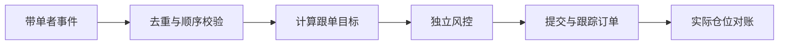

# 跟单交易：复制信号，为什么复制不了完全相同的收益

[← 返回学习导航](README.md)

> **学习目标**：理解跟单比例、成交偏差、系统同步和业绩评估。
>
> **建议先读**：[CEX 现货](CEX-Spot.md)、[CEX 合约](CEX-Contract.md)。

展开本篇目录

- [1. 跟单的本质](#section-1)
- [2. 三种复制方式](#section-2)
- [3. 比例跟单的算例](#section-3)
- [4. 现货与合约跟单](#section-4)
- [5. 系统如何保持一致](#section-5)
- [6. 如何看业绩](#section-6)
- [7. 自测与参考答案](#section-7)
- [8. 延伸阅读](#section-8)

---

## 1. 跟单的本质

跟单系统根据带单者的订单、成交或目标仓位，为跟单者生成自己的交易。它不是把带单者的收益直接转给跟单者，所有结果仍取决于各自账户的成交、费用和风控。

带单者不一定是经过验证的专业人士。平台榜单可以提供历史记录，但不能证明未来能力，也可能受到幸存者偏差和统计区间影响。

## 2. 三种复制方式

| 方式 | 例子 | 局限 |
| --- | --- | --- |
| 固定金额 | 每次信号买入 100 | 不同信号权重可能被扭曲 |
| 按资金比例 | 复制相同的权益占比 | 权益变化、杠杆与合约乘数要统一 |
| 目标仓位同步 | 跟随目标仓位从 5% 调到 8% | 需要可靠持仓数据和差量执行 |

复制“下单请求”与复制“实际成交”也不同。带单者挂单可能很久不成交，而跟单者若直接用市价跟随，就可能提前承担风险。

## 3. 比例跟单的算例

带单账户权益 10,000，计划建立名义价值 2,000 的仓位，占权益 20%。跟单者分配权益 1,000，若按同样名义敞口比例复制，目标仓位为 200。

这里比较的是名义价值，不是“保证金金额相同”。若平台复制的是保证金比例，还需结合杠杆换算。最小下单量、步长和余额限制可能让 200 无法精确执行。

如果跟单成交价比带单者差 0.5%，之后又支付更高费率，即使方向相同，净收益也不会完全一致。

## 4. 现货与合约跟单

普通现货跟单主要改变持有的资产数量，不使用杠杆时通常没有基于保证金的强制平仓，但资产仍可能大幅下跌。

合约跟单还需要统一方向、合约类型、名义价值、杠杆、全仓/逐仓与仓位模式。不能只复制 `BUY` 或 `SELL`：在不同持仓模式下，它可能表示开仓、减仓或平仓。

跟单者已有仓位也可能与复制策略冲突，最好明确账户隔离与净仓规则。

## 5. 系统如何保持一致

一次事件可能重复推送，也可能因断线晚到。系统应保存事件 ID、版本与状态，避免重复开仓；缺失事件后应通过实际仓位对账恢复，而不是盲目补发所有历史信号。

取消跟单时还需明确：停止新信号、取消未成交单、保留现仓还是按规则平仓。一个“停止”按钮不应隐藏这些差别。

## 6. 如何看业绩

| 指标 | 为什么要看 |
| --- | --- |
| 最大回撤 | 高收益背后是否承受过极大损失 |
| 未实现盈亏 | 是否通过不平亏损仓美化胜率 |
| 有效历史长度 | 是否只覆盖单一行情 |
| 杠杆与集中度 | 收益来自承担多大敞口 |
| 费用后跟单者收益 | 展示业绩是否接近用户实际结果 |

利润分成需要看结算周期、亏损是否结转和高水位线。若只对每次盈利单分成、亏损由跟单者单独承担，净体验可能明显低于表面收益。

## 7. 自测与参考答案

**问题**：复制五位带单者是否一定分散风险？

**答案**：不一定。如果五人都高杠杆做多同一种资产，实际风险高度相关，应按合并敞口评估。

**练习**：为跟单设置写出最大名义仓位、最大偏离价格、每日亏损限制和停止后的仓位处理四项规则。

## 8. 延伸阅读

- [滑点](滑点.md)、[风险控制与监控](风险控制与监控.md)、[网格交易](网格交易.md)。

---

[← 返回学习导航](README.md) · [回到顶部](#top)
