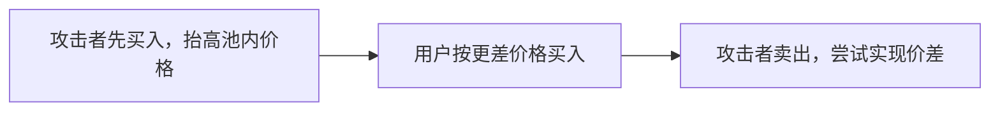

# 防夹：理解三明治攻击与交易保护边界

[← 返回学习导航](README.md)

> **学习目标**：理解链上 sandwich attack 的顺序，知道哪些措施能限制损失、哪些只改善体验。
>
> **建议先读**：[流动性池](流动性池.md)、[滑点](滑点.md)。

展开本篇目录

- [1. “夹子”在这里指什么](#section-1)
- [2. 三笔交易如何形成夹击](#section-2)
- [3. 为什么最低输出很重要](#section-3)
- [4. 防护方法与局限](#section-4)
- [5. 哪些说法容易误导](#section-5)
- [6. 如何复盘疑似被夹交易](#section-6)
- [7. 自测与参考答案](#section-7)
- [8. 延伸阅读](#section-8)

---

## 1. “夹子”在这里指什么

链上夹子攻击通常指攻击者把交易安排在受害者交易前后，利用受害者造成的价格变化获利。它与订单簿挂大单后撤单的诱导行为不是同一个机制。

MEV 是通过交易包含、排除或排序等方式获取价值的广义概念，包含套利、清算等活动；三明治攻击是其中一种，不等于所有 MEV。

## 2. 三笔交易如何形成夹击

假设用户准备在深度较小的池中买入代币，而且最低输出设置很宽。攻击者先买，使用户执行时得到更少代币；用户买入进一步推动价格后，攻击者再卖出。

真实结果还取决于手续费、Gas、排序竞争和其他交易，不是每次都能获利。攻击者也不一定拥有“大资金”，关键是可见订单、可排序空间和可获利的市场条件。

## 3. 为什么最低输出很重要

假设正常报价为 100 个代币，最低输出设为 95。在其他条件满足时，95 仍是用户明确允许的结果；如果最终只能输出 94，兑换应回滚。

这把损失限制在指定边界，但不会阻止别人把结果推向边界。报价本身若已经被操纵，基于该报价设置最低输出仍可能不利。

因此要同时检查报价来源、市场深度和参数。不能仅看到“开启滑点保护”就认定不会被夹。

## 4. 防护方法与局限

| 方法 | 主要作用 | 不能保证什么 |
| --- | --- | --- |
| 合理 `amountOutMin` | 限制最低到账 | 不保证报价正确或无人排序 |
| 选择更深的池或更好路线 | 降低交易对价格的冲击 | 不消除市场变化 |
| 私有交易通道 | 减少公开传播暴露 | 仍需信任相关参与者与路由行为 |
| 批量竞价或意图式执行 | 改变撮合与竞争机制 | 需评估具体协议和求解器规则 |
| 独立参考价与偏差约束 | 检查异常报价 | 参考价可能过期或被操纵 |

私有 RPC 的隐私政策、转发对象和失败时是否回退公开通道都要核对。自动回退可能重新暴露原本希望隐藏的交易。

## 5. 哪些说法容易误导

**“限制 Gas 价格就能防夹”**：Gas 上限控制费用，不控制其他人的排序权限。

**“使用闪电贷检测就安全”**：三明治攻击不必使用闪电贷，普通合约也不能用储备大小可靠推断资金来源。

**“拆成小单一定有效”**：拆分可能降低单笔可获利空间，也可能增加费用和多次暴露，需要根据执行路径分析。

**“交易失败没有成本”**：已上链但回滚的交易通常仍消耗 Gas。

## 6. 如何复盘疑似被夹交易

先保存交易哈希、报价时间、预期输出、最低输出和实际到账。再查看同池前后交易、储备变化、路由和代币行为。

仅看到“前后都有买卖”不足以认定攻击，还要分析交易关联与资金收益。普通套利、市场波动、代币税和过期报价也会造成结果差异。

开发者应把用户参数与最终执行参数对照，确认没有在重试或路由切换中悄悄放宽最低输出。

## 7. 自测与参考答案

**问题**：交易通过私有通道发送，还要设置最低输出吗？

**答案**：要。私有传播不能替代链上成交边界；市场变化、服务失败或额外参与者仍可能影响结果。

**练习**：为兑换确认页写出“预期到账、最低到账、报价时间、网络费”四项说明，让用户理解其差别。

## 8. 延伸阅读

- [Uniswap V2 底层与防夹](防夹.Uniswap%20V2%20AMM%20的底层实现和防夹策略.md)。
- [Ethereum MEV](https://ethereum.org/en/developers/docs/mev/)、[Flashbots 文档](https://docs.flashbots.net/)。

---

[← 返回学习导航](README.md) · [回到顶部](#top)
