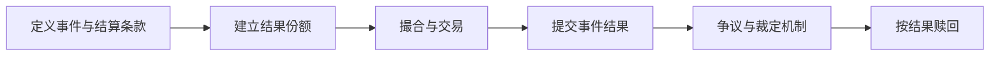

<a id="top"></a>

# 预测市场：交易的究竟是概率，还是结算规则

[← 学习总目录](README.md) · [近期热点导航](近期Web3热点导航.md)

> **学习目标**：理解结果份额、市场隐含概率、预言机和争议结算，避免把价格当成事实。
>
> **建议先读**：[CEX 现货](CEX-Spot.md)、[DeFi](DeFi.md)、[Layer3](Layer3.md)。
>
> **选题依据**：a16z 的 2025 报告讨论预测市场交易活动，2026 展望继续讨论其应用。资料核验日期：2026-11-09；相关平台并不全部采用相同链上架构。

<details>
<summary>展开本篇目录</summary>

- [1. 一个问题如何变成可交易资产](#section-1)
- [2. 0.63 的价格能说明什么](#section-2)
- [3. 从问题到兑付的流程](#section-3)
- [4. 读问题时先读五个条件](#section-4)
- [5. Polymarket、Kalshi 与通用概念](#section-5)
- [6. 为什么很高的成交量仍不够](#section-6)
- [7. 自测与参考答案](#section-7)
- [8. 资料与继续搜索](#section-8)

</details>

---


<a id="section-1"></a>

## 1. 一个问题如何变成可交易资产

预测市场围绕一个可判定事件发行或交易结果份额。例如“某产品是否在指定日期前公开发布”，可以有 YES 与 NO 两种结果。

在简化二元合约中，最终正确的一方每份兑付 1 单位，另一方兑付 0。价格反映交易者愿意为这一可能支付多少钱，但还受到费用、流动性、风险偏好和资本约束影响。

与普通代币不同，份额价值强烈依赖问题定义和结算规则。标题看起来相同，截止时间或证据来源不同，就可能是不同资产。

<a id="section-2"></a>

## 2. 0.63 的价格能说明什么

假设 YES 价格为 0.63，买入 100 份，成本为 63，忽略费用：

```text
若 YES 结算：兑付 100，利润 37
若 NO 结算：兑付 0，亏损 63
若提前按 0.70 卖出：收入 70，利润 7
```

价格可以近似理解为市场隐含概率信号，但不是客观的 63% 保证。合理解读需要看买卖价差、可成交规模、剩余期限和结算不确定性。

页面显示最后成交价 0.63，不表示现在能以同样价格买入所有数量。

<a id="section-3"></a>

## 3. 从问题到兑付的流程



条件代币框架可表达结果相关的资产权利；交易系统处理份额买卖；预言机与裁定机制将现实结果映射为可结算状态。这些模块不应混为一个“预测算法”。

某些市场采用订单簿，某些采用做市池。链下撮合、链上结算也可以组合，不能因为项目属于 Web3 就假定所有请求都实时在链上处理。

<a id="section-4"></a>

## 4. 读问题时先读五个条件

| 条件 | 为什么重要 |
| --- | --- |
| 明确事件 | “宣布发布”和“用户可用”可能不同 |
| 时间与时区 | 截止时刻会直接改变结果 |
| 指定来源 | 官方公告、统计机构或其他证据来源 |
| 异常处理 | 取消、延期、来源停更怎样处理 |
| 争议机制 | 谁可质疑、多久完成、需要什么保证金 |

一个现实例子是比赛延期：你认为球队最终赢了，但市场条款可能只认原定时段内的结果。买对常识判断，也可能买错合约条款。

<a id="section-5"></a>

## 5. Polymarket、Kalshi 与通用概念

Polymarket 可作为研究条件份额和交易接口的具体案例；Kalshi 是另一种事件合约平台案例。它们的准入、监管、交易和结算机制不能相互替代。

本次查询 Polymarket 旧 CTF Exchange 仓库时，页面已提示归档并转向 V2。接入者应从官方新入口确认版本与部署，不复制旧文章中的合约地址。

本文用通用模型教学，不提供当前合约地址、费率或地区可用性承诺。

<a id="section-6"></a>

## 6. 为什么很高的成交量仍不够

成交量可能来自重复换手，不等于愿意承担最终事件风险的资金规模。评估时还应看未平仓、盘口深度、单边集中度、订单取消和可用退出价格。

预测市场也可能出现信息优势、操纵、偏见或结算争议。把价格用于新闻判断或决策时，应与独立证据交叉核对。

<a id="section-7"></a>

## 7. 自测与参考答案

**问题**：YES 和 NO 的页面价格相加大于 1，是否一定存在无风险套利？

**答案**：不能仅凭展示价判断。需要区分买价与卖价、同时成交能力、费用、份额拆分合并条件和结算一致性。

**练习**：为“某产品年底前发布”写一份没有模糊词的结算规则，明确时区、公开可用定义、证据来源和延期处理。

<a id="section-8"></a>

## 8. 资料与继续搜索

- [Polymarket CTF Exchange 旧仓库](https://github.com/Polymarket/ctf-exchange)：本次已核实其归档及迁移提示。
- [Polymarket CTF Exchange V2](https://github.com/Polymarket/ctf-exchange-v2)：本次已读取 V2 README；具体集成仍需核对使用版本。
- [State of Crypto 2025](https://a16zfrontier.com/posts/article/state-of-crypto-report-2025/)、[2026 趋势展望](https://a16zfrontier.com/posts/article/big-ideas-things-excited-about-crypto-2026/)。
- **检索词**：`prediction markets`、`Polymarket`、`conditional tokens`、`resolution oracle`、`Kalshi`。

---

[← 学习总目录](README.md) · [近期热点导航](近期Web3热点导航.md) · [回到顶部](#top)
